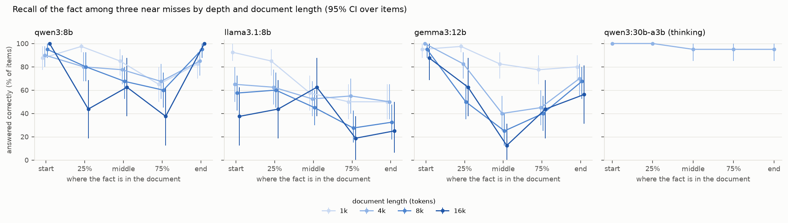

# long-context-recall

<a href="https://www.srikarmk.dev/series/measuring-llm-systems"></a> <a href="pyproject.toml"></a> <a href="LICENSE"></a>

**Question.** A model is given a long document with one fact in it that it cannot already know, and is
asked about that fact. As the document gets longer, and as the fact moves from the start to the middle
to the end, how often does the model still find it and use it? How much of any loss is due to length,
how much to position, and how much to similar-looking facts nearby? And does it still work when the
answer needs two facts from far apart in the document?

This repository is a measurement study with local open-weight models, the next in the series after
prompt-brittleness, memory-rot, rag-poisoning and llm-judge-bias. Every number in
[reports/results.md](reports/results.md) is produced by the code here from cached model calls, so it
regenerates exactly. Pre-registered predictions, with dated addenda: [HYPOTHESES.md](HYPOTHESES.md).

## Findings

Full run: 6,140 calls on 40 main items (16 at 16k for the depth grid, 20 for two-hop at 16k), four local
models at temperature 0. Twelve of the thirteen pre-registered predictions held; the full scoring is in
[reports/results.md](reports/results.md#9-pre-registered-predictions). Intervals are 95% bootstraps over
items.



- **One fact on its own is found at any length.** With nothing like it nearby, every main model
  answered 98 to 100% of items at every length from 1k to 16k tokens and at every depth. Length alone
  cost nothing measurable (16k minus 1k: +0.0 pp for all three).
- **Three similar facts nearby are what break it.** Each distractor is about an invented entity whose
  name differs from the key one by a word or a few letters, with a different person. At 4k they cut
  recall by 18.5 pp (`qwen3:8b`, to 80%), 42.5 pp (`llama3.1:8b`, to 57%) and 32.5 pp (`gemma3:12b`, to
  68%). With distractors, length then hurts: at 16k recall was 69%, 38% and 52%.
- **Position matters only once there is something to confuse.** With the fact alone, no depth was worse
  than any other. With distractors, `gemma3:12b` lost the middle (at 8k: 95% at the start, 25% in the
  middle; at 16k, 12% in the middle) and `qwen3:8b` the interior (75% depth worst at every length).
  `llama3.1:8b` instead favoured the start over the end (+27.5 pp, pooled over 1k to 8k).
- **Wrong answers name a distractor, usually an earlier one.** Wrong replies almost never invented a
  name: they named a distractor's person. When they did, it was one placed before the key fact 87%
  (`qwen3:8b`) and 82% (`llama3.1:8b`) of the time, against 63 to 65% by chance; `gemma3:12b` was close
  to chance (63% against 59%).
- **A missing fact gets filled in from a near miss.** With the key fact left out and nothing similar
  nearby, the models replied "not stated" on 98 to 100% of items. With the near misses present,
  `gemma3:12b` named a distractor's person on 98% of items, `qwen3:8b` on 57% and `llama3.1:8b` on 50%.
- **Two facts far apart are combined less often, and much less at 16k.** Next to each other, the two
  facts of a two-hop question ("where was the designer of X born?") were combined 92 to 100% of the
  time. With one at 10% and the other at 90% of a 16k document, `llama3.1:8b` managed 30% and 10% (the
  two orders), `gemma3:12b` 35% and 20%, `qwen3:8b` 80% and 60%, though each model answered the second
  hop on its own at 75 to 100%. The predicted order effect (birthplace first is harder) did not hold.
- **The thinking model was not fooled.** `qwen3:30b-a3b` with thinking (on 20 items at 4k) answered 97%
  with distractors, 21.0 pp above `qwen3:8b` on the same items [+8.0, +35.0], named a distractor on 1 of
  20 items with the fact left out, and combined far-apart facts every time. That is confounded with size
  and thinking, and it took about 7 seconds a call against 3.
- **The noise floor is close to zero.** The identical prompt sent twice flipped 0 of 200 times for the
  two 8B models and 1 of 200 for `gemma3:12b`. Closed-book, no model answered any question correctly,
  but `gemma3:12b` named a person instead of saying "not stated" on 68 to 82% of them.

**What this means in practice.** A single-needle test says these models read 16k tokens reliably. They
do, until the document holds other facts of the same shape, which real documents (contracts, logs,
tickets, product catalogues) usually do. A long-context check that matters plants near misses, leaves
the fact out on some items, and asks questions that need two facts far apart.

The answer checker has not yet been checked by hand: the sample in `handcheck/sample.csv` is waiting
for labels (see [Hand-check](#hand-check)).

## Design

**Facts the model cannot know.** Each item is one invented entity (the Wendwater Museum, the
Vellmark Viaduct, the Ostmoor Expedition, the Quenvale Overture) and the person tied to it by one of four
relations: founded, designed, led, composed ([src/lcrecall/facts.py](src/lcrecall/facts.py)). The fact is
a short paragraph of two sentences ("The Wendwater Museum shows clocks, compasses and other instruments
made in the region. It was founded in 1874 by the collector Zelie Thorningham."), and the question names
the entity ("Who founded the Wendwater Museum?"). Fourteen entity types, three intro sentences each.
Every surname, entity name and town is built from invented syllables and checked against every word in
the filler corpus, so the answer can come only from the document; a closed-book call per item (the
question with no document) checks that no model knows it.

**Real filler.** Documents are WikiText-2 article prose, several articles one after another, each with
its title line. An item's filler starts at its own article (seeded), and a level's document is that
stream cut at the last sentence end within the level's character budget. The 1k document is the first
part of the 4k document, which is the first part of the 8k one, and so on, so a longer document is the
shorter one with more text after it.

| level | characters | prompt tokens (pilot, mean over models) |
|---|---|---|
| 1k | 3,900 | about 1,050 |
| 4k | 15,600 | about 3,800 |
| 8k | 31,200 | about 7,200 |
| 16k | 62,400 | about 13,900 |
| 32k | 124,800 | about 27,300 |

**Placement.** A fact is placed at depth 0 (start), 25%, 50% (middle), 75% or 1 (end) of the document,
at the sentence boundary nearest that share of its characters, as its own paragraph. The depth reached
is recorded with every call (within 1 to 3% of the target).

**Factors, one at a time, every comparison paired by item.** The same fact of an item is used in every
cell, so a difference between two cells is a difference on the same items.

| factor | cells | items in the grid |
|---|---|---|
| length x position, fact alone | 1k, 4k, 8k x 5 depths; 16k x 5 depths | 40; 16 |
| near-miss distractors | the same cells with three distractors added: 1k, 4k, 8k x 5 depths; 16k x 5 depths | 40; 16 |
| fact absent | 4k with no key fact, with and without the distractors (right reply: `not stated`) | 40 |
| two-hop | 4k and 16k: the two facts adjacent in the middle, or at 10% and 90% in either order; the second hop alone | 40 at 4k, 20 at 16k |
| closed-book | the key question and the second-hop question with no document | 40 |
| A/A noise floor | each item's five with-distractor cells at one of 1k, 4k, 8k (rotating) sent again | 40 |

*Distractors* are near misses: three more fact paragraphs, each naming a different invented person,
about an entity that shares the key entity's name but not its type (the Wendwater Library beside the
Wendwater Museum), shares its type and the beginning of its name (the Wendreach Museum), or its type and
the end of its name (the Grimwater Museum). Each sits at a seeded depth in its own band (5 to 19%, 31 to
44%, 56 to 69%, 81 to 95%), away from the five key positions, at the same depths for every length and
key position of that item. They add about 100 tokens.

*Two-hop.* "In which town was the founder of the Wendwater Museum born?" needs the key fact (entity to
person) and a second fact ("Zelie Thorningham was born in the town of Ivelstow, ..."). Two other invented
people's birthplaces sit at 30% and 70% as decoys, so a model that skips the first hop has only a
one-in-three chance. The second hop alone ("In which town was Zelie Thorningham born?") is asked in the
far-forward document, which separates failing to find the second fact from failing to combine the two.

**Prompt** ([src/lcrecall/prompts.py](src/lcrecall/prompts.py)). One user message: an instruction to
answer from the document only, the document in `<document>` tags, the question, and "Reply with only the
answer, in a few words, and no explanation. If the document does not give the answer, reply exactly: not
stated". The question comes after the document. The closed-book prompt has no document and offers
"unknown" instead.

**Checking the answer** ([src/lcrecall/check.py](src/lcrecall/check.py)). Every candidate answer is an
invented surname or town that occurs nowhere in the filler, so the checker matches whole words after
lower-casing and stripping accents and punctuation. A reply is `correct` (names the right answer and no
near miss), `mixed` (names both), `wrong_entity` (names a distractor's person or a decoy town),
`bridge` (two-hop: names the intermediate person but no town), `abstain` ("not stated", "unknown", "the
document does not say") or `other`. Accuracy counts only `correct` (or, with the fact absent, `abstain`).

**Measures.** Per model and cell, the share of items answered correctly; length effects (each length
minus 1k, all depths); position effects (middle minus the mean of start and end, interior minus ends,
start minus end); distractor effects (with minus without, by depth and length); the outcome mix (near
miss named, abstained, other); where a named distractor sat relative to the key fact, against chance;
two-hop accuracy by placement, against the second hop alone; the A/A flip rate (correctness differs
between two identical calls). An effect counts only when its 95% interval excludes zero and it is larger
than the model's A/A flip rate.

**Statistics.** 95% percentile bootstraps over items (2,000 draws); an item's cells move together. The
bootstrap and the A/A rule follow llm-judge-bias, prompt-brittleness and memory-rot in the same series.

**Context and truncation.** Ollama shortens an over-long prompt to about half of `num_ctx` without any
error (seen while setting up: an 8,799-token prompt at `num_ctx` 8,500 came back as 4,252 evaluated
tokens). Every call here uses `num_ctx` 33,792, which fits the longest prompt (about 27,600 tokens in
the pilot, inside `qwen3:8b`'s 32,768-token native window) and the answer for every model; it is the
same for every length, because
Ollama reloads the model (and drops its prompt cache) whenever `num_ctx` changes, and a value that grew
with length would confound length with the server's allocation. Before a call is sent, its estimated
tokens plus the answer budget must fit `num_ctx` and the native window; after it returns, the server's
`prompt_eval_count` must be within 0.7 to 1.4 times the estimate (characters per token calibrated on the
first pilot) and must fit `num_ctx`, or the run stops with an error. Across the 804 pilot calls the
ratio stayed between 0.93 and 1.07.

**Run order and speed.** Prompts of one item are sent one after another, sorted by text, so the server
reuses the longest shared prefix of the previous prompt (the documents are nested); at 1k to 8k this
cut the pilot's prefill time by about a third, and it should change nothing else (see Limits). Stages
run one at a time, each for every main model before the next (one model at a time: long prompts are
compute-bound, so models side by side would not finish sooner), in the order closed-book, 1k to 8k alone, 4k with distractors and fact absent,
two-hop at 4k, 1k and 8k with distractors, A/A, 16k alone and with distractors, two-hop at 16k, and
then `qwen3:30b-a3b` on its reduced grid (closed-book, distractors and two-hop at 4k on 20 items). A cut
keeps the short and middle lengths at every depth first. 32k is not in the planned grid (about 23
minutes per item for the three main models); it can be added afterwards and would be exploratory.

## Reproduce

Requires [uv](https://docs.astral.sh/uv/) and [Ollama](https://ollama.com) with the four models pulled.

```sh
uv sync
uv run lcrecall fetch          # pinned WikiText-2 file, sha256-checked (6.4 MB)
uv run lcrecall items          # data/items.jsonl: 60 main items and 6 pilot items, seeded
uv run lcrecall show main-00 --cell 'key|4k|0.50|distract|'   # a rendered prompt (and output, once run)
# pilot (excluded from results)
uv run lcrecall run --split pilot --models qwen3:8b,llama3.1:8b --stage closed,short,distract,twohop,distract_len,aa
uv run lcrecall run --split pilot --models qwen3:8b,llama3.1:8b --stage long16,twohop16 --n-items 3
uv run lcrecall report --split pilot        # reports/pilot.md
uv run lcrecall plan                        # calls and hours of the planned grid at the pilot's speed
# the full grid (needs mains power; about 8.5 hours, see RUN.md)
pmset -g batt | grep -q "AC Power" && caffeinate -dims \
  uv run lcrecall run --grid --models qwen3:8b,llama3.1:8b,gemma3:12b --late-models qwen3:30b-a3b \
  2>&1 | tee -a logs/full.log
uv run lcrecall handcheck sample   # handcheck/sample.csv, labels left empty
uv run lcrecall report             # reports/results.md and reports/figures/
uv run pytest
```

The full pilot script (all four models, including 32k on one item) is in [RUN.md](RUN.md). Every model
call is cached in `cache/llm.sqlite`, keyed by model, messages, options, think flag and a repeat tag
(each A/A repeat has its own entry, so it is a real second call with the identical request). With the
cache present, `lcrecall run --grid ... --cache-only` rebuilds every row without a server, and `report`
re-checks every stored output, so changing a checker rule updates every number. An interrupted run
resumes from the cache.

## Data and models

| Item | Source | Version | Size | Licence |
|---|---|---|---|---|
| WikiText-2 (raw), train split | Hugging Face `Salesforce/wikitext`, `wikitext-2-raw-v1/train-00000-of-00001.parquet` | commit `b08601e04326c79dfdd32d625aee71d232d685c3` | 6,357,543 bytes | CC BY-SA 3.0 (and GFDL) |
| Models | Ollama 0.40.6 library tags `qwen3:8b`, `llama3.1:8b`, `gemma3:12b`, `qwen3:30b-a3b` (Q4_K_M) | digests in `results/models.json` | 4.9 to 18.6 GB | Apache 2.0 (Qwen3), Llama 3.1 Community Licence, Gemma Terms of Use |

The sha256 is pinned in `src/lcrecall/config.py` and recorded in `data/sources.json`. The filler keeps
WikiText's article prose only: 604 articles, 13,690 paragraphs of at least 40 words, 9.8 million
characters, with WikiText's tokenised punctuation put back (` @-@ ` to `-`, ` , ` to `,`) and dense
paragraphs (more than 6% digits or non-ASCII characters: score lines, coordinates) dropped.

Context windows, from `ollama show`: `qwen3:8b` 40,960 (the Qwen3-8B model card gives 32,768 as its
native window, the rest being room for output), `llama3.1:8b` and `gemma3:12b` 131,072,
`qwen3:30b-a3b` 262,144. Settings: temperature 0, seed 7, `num_ctx` 33,792 on every call, at most 48
new tokens; `think: false` for `qwen3:8b`, and `think: true` with a 2,048-token cap for `qwen3:30b-a3b`,
the thinking-only release, which keeps reasoning when thinking is turned off (found in memory-rot); only
its final answer is checked. One call at a time.

## Layout

```
src/lcrecall/  config (settings, grid), data (fetch, filler paragraphs), facts (invented entities, people,
               near misses, templates), items (the seeded item set), context (documents, placement),
               prompts (templates, cells), check (answer checker), llm (Ollama + disk cache), runner
               (stages, token check), stats (item bootstrap), analysis, hypotheses (scoring of the
               predictions), report, handcheck, cli
tests/         checker, documents and placement, items, cache and token check, bootstrap, analysis
data/          items.jsonl (the items) and sources.json (file, revision, sha256)
results/       rows/<model>.jsonl (one row per call) and models.json (digests, settings)
reports/       results.md and figures/ (full run), pilot.md and pilot_figures/
handcheck/     sample.csv and pilot_sample.csv (label column empty), *parser_key.csv
cache/         llm.sqlite: every model call
```

## Hand-check

`handcheck/pilot_sample.csv` holds a seeded sample of pilot outputs (stratified by task, plus every
pilot output the checker put in `other` or `mixed` or that ran longer than a short answer) with the
question, the right answer, the near-miss answers it could be confused with, the raw output and an
empty `label` column; the checker's reading is kept apart in `handcheck/pilot_parser_key.csv`. After the
full run, `lcrecall handcheck sample` writes the same for the main run (`handcheck/sample.csv`: 60
random outputs stratified by task plus up to 20 hard ones). None of these has been labelled: the
labelling pass is Srikar's, and no agreement figure is reported until it is done. Labels are one of
`correct`, `mixed`, `wrong_entity`, `bridge`, `abstain`, `other` (definitions in
[src/lcrecall/check.py](src/lcrecall/check.py)).

## Limits

- **Small models, small grid.** Four local models, 4-bit quantised, one prompt template, temperature 0
  and one seed, sized from the pilot to fit a night of laptop compute. Intervals on the long-context
  cells, which run on fewer items, are wide.
- **Synthetic facts in real filler.** The planted paragraphs are short, self-contained and about
  invented entities, so they differ in style from the Wikipedia text around them; a model may find
  them by that difference rather than by reading. Real documents bury facts in text on the same
  topic. The near-miss distractors are the study's way of making the search harder, and they are one
  hand-written kind (similar names, same relation).
- **Lexical overlap.** Every question repeats the entity's name, which appears verbatim in the fact.
  NoLiMa shows that removing this overlap makes long-context recall much harder; this study does not.
- **Templates.** Fourteen entity types with three intro sentences each; the relation and the
  question wording are fixed per type. The facts are built so a checker can grade them, which also
  makes them more regular than real text.
- **Two hops, one shape.** The two-hop task is one fixed chain (entity to person, person to birth
  town), with two decoy birthplaces at fixed depths. Composition over longer chains, or over facts
  that need inference, is not tested.
- **Prompt cache.** Calls of an item are sent in prompt order, so the server reuses the shared prefix
  of the previous prompt. This changes speed, and could in principle change the floating-point path of
  a computation; the A/A repeat, sent in a later stage under a different cache state, measures that
  noise along with the rest.
- **One num_ctx.** Every call allocates 33,792 tokens of context whatever its length, so length is not
  confounded with the server's allocation, but results at the default allocation (2,048 or 4,096,
  which would silently truncate most of these prompts) are not what is measured.
- **Lengths are nominal.** A level's document is cut by characters, the same text for every model,
  so each model sees a slightly different number of tokens (reported per model and level).
- The templates, the checker and the predictions were written by the same person who will label the
  hand-check sample.

## Prior work

- Liu et al. *Lost in the Middle: How Language Models Use Long Contexts.* TACL 2024
  ([arXiv:2307.03172](https://arxiv.org/abs/2307.03172)). Multi-document QA and key-value retrieval:
  accuracy is highest when the relevant document is first or last and lowest in the middle (a U
  shape), and falls as more documents are added.
- Kamradt. *Needle In A Haystack: pressure testing LLMs* (2023,
  [github.com/gkamradt/LLMTest_NeedleInAHaystack](https://github.com/gkamradt/LLMTest_NeedleInAHaystack)).
  One planted sentence in essay filler, swept over length and depth; the template for this study's
  single-fact grid.
- Hsieh et al. *RULER: What's the Real Context Size of Your Long-Context Language Models?* COLM 2024
  ([arXiv:2404.06654](https://arxiv.org/abs/2404.06654)). Plain needle retrieval is near perfect for
  most models; multi-key needles with distractors, variable tracing and aggregation fall well before
  the advertised window.
- Kuratov et al. *BABILong: Testing the Limits of LLMs with Long Context Reasoning-in-a-Haystack.*
  NeurIPS 2024 Datasets and Benchmarks ([arXiv:2406.10149](https://arxiv.org/abs/2406.10149)). bAbI
  facts, including multi-hop chains, spread through book filler; reasoning over facts degrades with
  length far more than retrieval of one fact.
- Levy, Jacoby and Goldberg. *Same Task, More Tokens: the Impact of Input Length on the Reasoning
  Performance of Large Language Models.* ACL 2024 ([arXiv:2402.14848](https://arxiv.org/abs/2402.14848)).
  Two-fact reasoning gets worse as irrelevant padding grows, at lengths far below the context window.
- Modarressi et al. *NoLiMa: Long-Context Evaluation Beyond Literal Matching.* ICML 2025
  ([arXiv:2502.05167](https://arxiv.org/abs/2502.05167)). When the question shares no words with the
  needle, recall drops sharply with length; much of plain needle success is lexical matching.
- Shi et al. *Large Language Models Can Be Easily Distracted by Irrelevant Context.* ICML 2023
  ([arXiv:2302.00093](https://arxiv.org/abs/2302.00093)). Irrelevant sentences added to maths problems
  lower accuracy.
- Press et al. *Measuring and Narrowing the Compositionality Gap in Language Models.* Findings of EMNLP
  2023 ([arXiv:2210.03350](https://arxiv.org/abs/2210.03350)). Models that answer both single hops often
  fail the composed two-hop question; this study measures the same gap with both hops in the context.
- Hsieh et al. *Found in the Middle: Calibrating Positional Attention Bias Improves Long Context
  Utilization.* Findings of ACL 2024 ([arXiv:2406.16008](https://arxiv.org/abs/2406.16008)). Links the
  middle dip to a positional attention bias.
- Filler: Merity et al. *Pointer Sentinel Mixture Models* (WikiText, ICLR 2017,
  [arXiv:1609.07843](https://arxiv.org/abs/1609.07843)).

What this study adds, if the run goes as planned: length, position and near-miss distractors varied
one at a time on the same invented facts (so every comparison is paired by item and closed-book
knowledge is ruled out per item), with the reply classified as right, a near miss, an abstention or
something else, a two-hop task with the hops adjacent or far apart in both orders, a fact-absent
control, and an A/A noise floor, on four local open models.

## License

MIT, Kameswara Sai Srikar Manda, 2026. The filler is WikiText-2 (Merity et al.), derived from Wikipedia
and licensed CC BY-SA 3.0 (and GFDL); documents built from it, and `data/items.jsonl`, which holds only
invented facts and pointers into the filler, keep that licence for the filler text.
