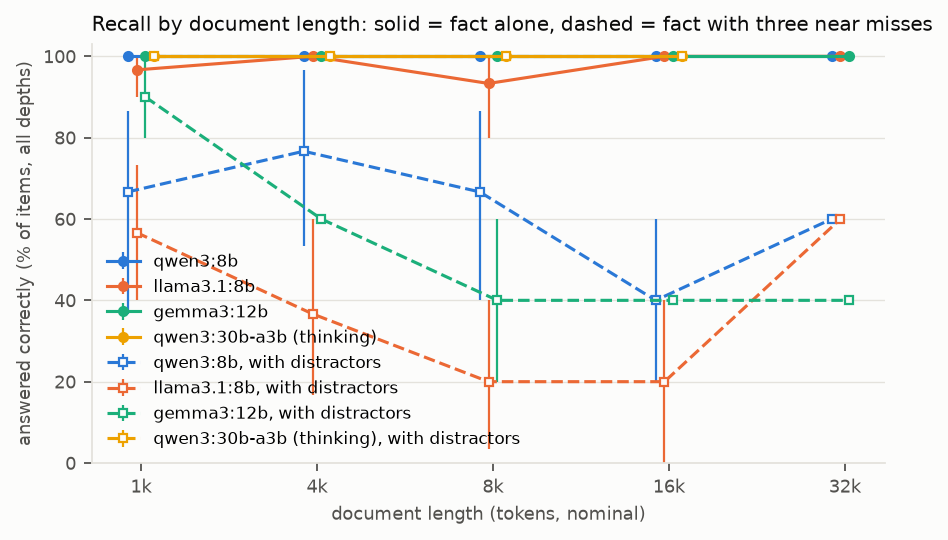
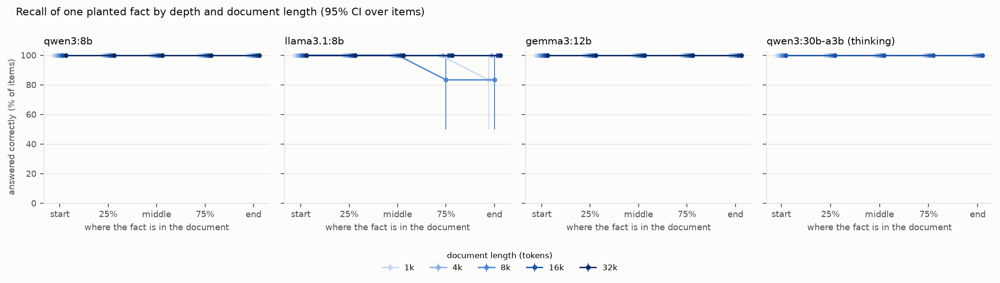
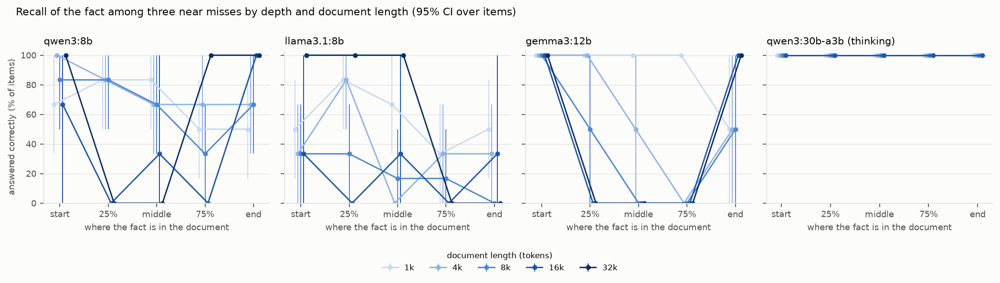
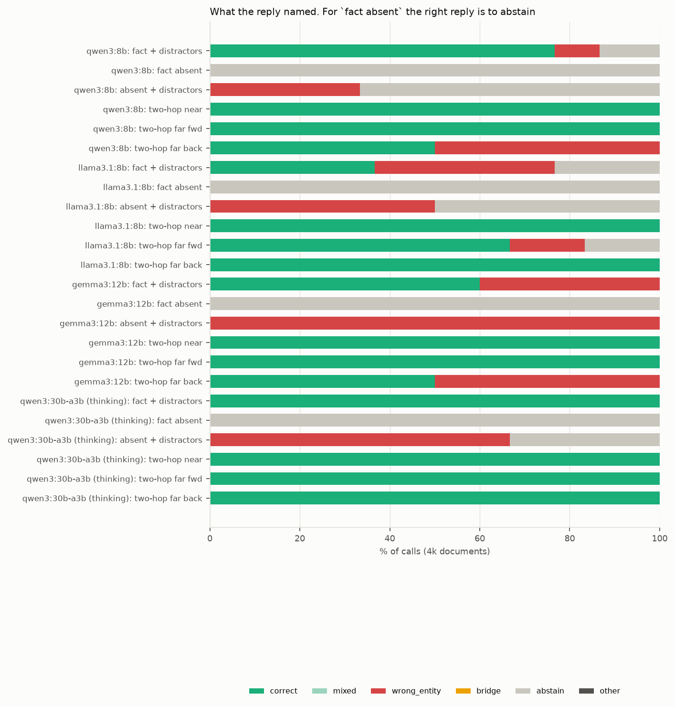

# Results

Generated by `uv run lcrecall report --split pilot` from `results/rows/*.jsonl` and `data/items.jsonl`. Every number below is computed by code from cached model outputs, re-checked with the current answer checker. Intervals are 95% percentile bootstraps (2,000 resamples) over items: every cell of an item holds the same fictional fact, so an item's cells move together and differences between cells are paired by item. `pp` = percentage points; `*` marks a difference whose interval excludes zero.

**Pilot split.** These are the pilot items, used only to check prompts, the checker, the token check and timing. They are excluded from every reported result.

## Headline

- **qwen3:8b**, recall over all depths, fact alone: 1k 100% [100, 100]; 4k 100% [100, 100]; 8k 100% [100, 100]; 16k 100% [100, 100]; 32k 100% [100, 100]. with distractors: 1k 67% [37, 87]; 4k 77% [53, 97]; 8k 67% [40, 87]; 16k 40% [20, 60]; 32k 60% [60, 60]. Two-hop at 4k: adjacent 100% [100, 100], far 100% [100, 100] / 50% [17, 83]. A/A flip rate 0.0% [0.0, 0.0].
- **llama3.1:8b**, recall over all depths, fact alone: 1k 97% [90, 100]; 4k 100% [100, 100]; 8k 93% [80, 100]; 16k 100% [100, 100]; 32k 100% [100, 100]. with distractors: 1k 57% [40, 73]; 4k 37% [17, 60]; 8k 20% [3, 40]; 16k 20% [0, 40]; 32k 60% [60, 60]. Two-hop at 4k: adjacent 100% [100, 100], far 67% [33, 100] / 100% [100, 100]. A/A flip rate 0.0% [0.0, 0.0].
- **gemma3:12b**, recall over all depths, fact alone: 1k 100% [100, 100]; 4k 100% [100, 100]; 8k 100% [100, 100]; 16k 100% [100, 100]; 32k 100% [100, 100]. with distractors: 1k 90% [80, 100]; 4k 60% [60, 60]; 8k 40% [20, 60]; 16k 40% [40, 40]; 32k 40% [40, 40]. Two-hop at 4k: adjacent 100% [100, 100], far 100% [100, 100] / 50% [0, 100]. A/A flip rate 0.0% [0.0, 0.0].
- **qwen3:30b-a3b (thinking)**, recall over all depths, fact alone: 1k 100% [100, 100]; 4k 100% [100, 100]; 8k 100% [100, 100]; 16k 100% [100, 100]. with distractors: 1k 100% [100, 100]; 4k 100% [100, 100]; 8k 100% [100, 100]; 16k 100% [100, 100]. Two-hop at 4k: adjacent 100% [100, 100], far 100% [100, 100] / 100% [100, 100].

## 1. Setup and token check

Every call uses num_ctx 33,792. `ratio` = the server's prompt_eval_count over the estimate (characters / chars-per-token + template tokens); a call outside [0.7, 1.4] or over num_ctx would have stopped the run (Ollama shortens an over-long prompt silently), so every row below passed. `wall` = median seconds per call, including prefix reuse within an item.

| model | digest | length | calls | items | mean prompt tokens | max | ratio | median wall s/call | median prefill tok/s | output tokens | thinking chars | hit answer cap |
|---|---|---|---|---|---|---|---|---|---|---|---|---|
| qwen3:8b | 500a1f067a9f | closed | 12 | 6 | 59 | 62 | 0.97 to 1.03 | 0.1 | 649 | 2 | 0 | 0.0% |
| qwen3:8b | 500a1f067a9f | 1k | 60 | 6 | 1,080 | 1,188 | 0.97 to 1.07 | 0.8 | 1,601 | 6 | 0 | 0.0% |
| qwen3:8b | 500a1f067a9f | 4k | 126 | 6 | 3,837 | 4,037 | 0.97 to 1.07 | 2.9 | 1,400 | 5 | 0 | 0.0% |
| qwen3:8b | 500a1f067a9f | 8k | 60 | 6 | 7,362 | 7,782 | 0.95 to 1.05 | 4.8 | 1,599 | 6 | 0 | 0.0% |
| qwen3:8b | 500a1f067a9f | 16k | 42 | 3 | 14,169 | 15,085 | 0.93 to 1.03 | 16.7 | 880 | 5 | 0 | 0.0% |
| qwen3:8b | 500a1f067a9f | 32k | 10 | 1 | 27,590 | 27,642 | 0.95 to 0.95 | 41.6 | 669 | 6 | 0 | 0.0% |
| llama3.1:8b | 46e0c10c039e | closed | 12 | 6 | 53 | 56 | 0.98 to 1.06 | 0.1 | 606 | 2 | 0 | 0.0% |
| llama3.1:8b | 46e0c10c039e | 1k | 60 | 6 | 1,041 | 1,147 | 0.97 to 1.07 | 0.8 | 1,522 | 6 | 0 | 0.0% |
| llama3.1:8b | 46e0c10c039e | 4k | 126 | 6 | 3,700 | 3,861 | 0.98 to 1.05 | 2.8 | 1,412 | 5 | 0 | 0.0% |
| llama3.1:8b | 46e0c10c039e | 8k | 60 | 6 | 7,117 | 7,505 | 0.95 to 1.04 | 4.4 | 1,675 | 6 | 0 | 0.0% |
| llama3.1:8b | 46e0c10c039e | 16k | 42 | 3 | 13,782 | 14,590 | 0.94 to 1.02 | 15.5 | 903 | 6 | 0 | 0.0% |
| llama3.1:8b | 46e0c10c039e | 32k | 10 | 1 | 26,896 | 26,945 | 0.95 to 0.95 | 43.2 | 645 | 7 | 0 | 0.0% |
| gemma3:12b | b92b218582c5 | closed | 4 | 2 | 55 | 57 | 1.00 to 1.04 | 0.3 | 269 | 4 | 0 | 0.0% |
| gemma3:12b | b92b218582c5 | 1k | 20 | 2 | 1,028 | 1,125 | 0.97 to 1.02 | 1.9 | 609 | 7 | 0 | 0.0% |
| gemma3:12b | b92b218582c5 | 4k | 42 | 2 | 3,785 | 3,835 | 1.00 to 1.02 | 6.2 | 636 | 6 | 0 | 0.0% |
| gemma3:12b | b92b218582c5 | 8k | 20 | 2 | 7,158 | 7,255 | 0.98 to 0.98 | 7.4 | 1,009 | 6 | 0 | 0.0% |
| gemma3:12b | b92b218582c5 | 16k | 14 | 1 | 13,707 | 13,752 | 0.94 to 0.95 | 22.7 | 611 | 6 | 0 | 0.0% |
| gemma3:12b | b92b218582c5 | 32k | 10 | 1 | 27,365 | 27,418 | 0.95 to 0.95 | 44.6 | 621 | 6 | 0 | 0.0% |
| qwen3:30b-a3b (thinking) | ad815644918f | closed | 6 | 3 | 54 | 56 | 0.93 to 1.00 | 3.7 | 589 | 292 | 1,234 | 0.0% |
| qwen3:30b-a3b (thinking) | ad815644918f | 1k | 10 | 1 | 1,075 | 1,127 | 1.01 to 1.02 | 4.2 | 2,008 | 304 | 1,193 | 0.0% |
| qwen3:30b-a3b (thinking) | ad815644918f | 4k | 38 | 3 | 3,876 | 4,031 | 1.01 to 1.07 | 6.5 | 1,545 | 327 | 1,262 | 0.0% |
| qwen3:30b-a3b (thinking) | ad815644918f | 8k | 10 | 1 | 7,338 | 7,390 | 1.00 to 1.00 | 8.2 | 1,827 | 317 | 1,301 | 0.0% |
| qwen3:30b-a3b (thinking) | ad815644918f | 16k | 10 | 1 | 13,840 | 13,892 | 0.95 to 0.95 | 16.0 | 1,043 | 205 | 797 | 0.0% |

## 2. Closed-book control

The question with no document. Every answer is invented, so a correct reply here would mean the answer leaked into the question or the model guessed it.

| model | question | calls | correct | abstain | near-miss name | other name |
|---|---|---|---|---|---|---|
| qwen3:8b | key question | 6 | 0% [0, 0] | 100% [100, 100] | 0% [0, 0] | 0% [0, 0] |
| qwen3:8b | second-hop question | 6 | 0% [0, 0] | 100% [100, 100] | 0% [0, 0] | 0% [0, 0] |
| llama3.1:8b | key question | 6 | 0% [0, 0] | 100% [100, 100] | 0% [0, 0] | 0% [0, 0] |
| llama3.1:8b | second-hop question | 6 | 0% [0, 0] | 100% [100, 100] | 0% [0, 0] | 0% [0, 0] |
| gemma3:12b | key question | 2 | 0% [0, 0] | 0% [0, 0] | 0% [0, 0] | 100% [100, 100] |
| gemma3:12b | second-hop question | 2 | 0% [0, 0] | 0% [0, 0] | 0% [0, 0] | 100% [100, 100] |
| qwen3:30b-a3b (thinking) | key question | 3 | 0% [0, 0] | 100% [100, 100] | 0% [0, 0] | 0% [0, 0] |
| qwen3:30b-a3b (thinking) | second-hop question | 3 | 0% [0, 0] | 100% [100, 100] | 0% [0, 0] | 0% [0, 0] |

## 3. Recall by length and depth

Share of items answered correctly with the key fact at each depth, alone and with the three near-miss distractors. `all` averages an item's five depths.







**qwen3:8b, fact alone**

| length | items | start | 25% | middle | 75% | end | all |
|---|---|---|---|---|---|---|---|
| 1k | 6 | 100% [100, 100] | 100% [100, 100] | 100% [100, 100] | 100% [100, 100] | 100% [100, 100] | 100% [100, 100] |
| 4k | 6 | 100% [100, 100] | 100% [100, 100] | 100% [100, 100] | 100% [100, 100] | 100% [100, 100] | 100% [100, 100] |
| 8k | 6 | 100% [100, 100] | 100% [100, 100] | 100% [100, 100] | 100% [100, 100] | 100% [100, 100] | 100% [100, 100] |
| 16k | 3 | 100% [100, 100] | 100% [100, 100] | 100% [100, 100] | 100% [100, 100] | 100% [100, 100] | 100% [100, 100] |
| 32k | 1 | 100% [100, 100] | 100% [100, 100] | 100% [100, 100] | 100% [100, 100] | 100% [100, 100] | 100% [100, 100] |

**qwen3:8b, with distractors**

| length | items | start | 25% | middle | 75% | end | all |
|---|---|---|---|---|---|---|---|
| 1k | 6 | 67% [33, 100] | 83% [50, 100] | 83% [50, 100] | 50% [17, 83] | 50% [17, 83] | 67% [37, 87] |
| 4k | 6 | 100% [100, 100] | 83% [50, 100] | 67% [33, 100] | 67% [33, 100] | 67% [33, 100] | 77% [53, 97] |
| 8k | 6 | 83% [50, 100] | 83% [50, 100] | 67% [33, 100] | 33% [0, 67] | 67% [33, 100] | 67% [40, 87] |
| 16k | 3 | 67% [0, 100] | 0% [0, 0] | 33% [0, 100] | 0% [0, 0] | 100% [100, 100] | 40% [20, 60] |
| 32k | 1 | 100% [100, 100] | 0% [0, 0] | 0% [0, 0] | 100% [100, 100] | 100% [100, 100] | 60% [60, 60] |

**llama3.1:8b, fact alone**

| length | items | start | 25% | middle | 75% | end | all |
|---|---|---|---|---|---|---|---|
| 1k | 6 | 100% [100, 100] | 100% [100, 100] | 100% [100, 100] | 100% [100, 100] | 83% [50, 100] | 97% [90, 100] |
| 4k | 6 | 100% [100, 100] | 100% [100, 100] | 100% [100, 100] | 100% [100, 100] | 100% [100, 100] | 100% [100, 100] |
| 8k | 6 | 100% [100, 100] | 100% [100, 100] | 100% [100, 100] | 83% [50, 100] | 83% [50, 100] | 93% [80, 100] |
| 16k | 3 | 100% [100, 100] | 100% [100, 100] | 100% [100, 100] | 100% [100, 100] | 100% [100, 100] | 100% [100, 100] |
| 32k | 1 | 100% [100, 100] | 100% [100, 100] | 100% [100, 100] | 100% [100, 100] | 100% [100, 100] | 100% [100, 100] |

**llama3.1:8b, with distractors**

| length | items | start | 25% | middle | 75% | end | all |
|---|---|---|---|---|---|---|---|
| 1k | 6 | 50% [17, 83] | 83% [50, 100] | 67% [33, 100] | 33% [0, 67] | 50% [17, 83] | 57% [40, 73] |
| 4k | 6 | 33% [0, 67] | 83% [50, 100] | 0% [0, 0] | 33% [0, 67] | 33% [0, 67] | 37% [17, 60] |
| 8k | 6 | 33% [0, 67] | 33% [0, 67] | 17% [0, 50] | 17% [0, 50] | 0% [0, 0] | 20% [3, 40] |
| 16k | 3 | 33% [0, 100] | 0% [0, 0] | 33% [0, 100] | 0% [0, 0] | 33% [0, 100] | 20% [0, 40] |
| 32k | 1 | 100% [100, 100] | 100% [100, 100] | 100% [100, 100] | 0% [0, 0] | 0% [0, 0] | 60% [60, 60] |

**gemma3:12b, fact alone**

| length | items | start | 25% | middle | 75% | end | all |
|---|---|---|---|---|---|---|---|
| 1k | 2 | 100% [100, 100] | 100% [100, 100] | 100% [100, 100] | 100% [100, 100] | 100% [100, 100] | 100% [100, 100] |
| 4k | 2 | 100% [100, 100] | 100% [100, 100] | 100% [100, 100] | 100% [100, 100] | 100% [100, 100] | 100% [100, 100] |
| 8k | 2 | 100% [100, 100] | 100% [100, 100] | 100% [100, 100] | 100% [100, 100] | 100% [100, 100] | 100% [100, 100] |
| 16k | 1 | 100% [100, 100] | 100% [100, 100] | 100% [100, 100] | 100% [100, 100] | 100% [100, 100] | 100% [100, 100] |
| 32k | 1 | 100% [100, 100] | 100% [100, 100] | 100% [100, 100] | 100% [100, 100] | 100% [100, 100] | 100% [100, 100] |

**gemma3:12b, with distractors**

| length | items | start | 25% | middle | 75% | end | all |
|---|---|---|---|---|---|---|---|
| 1k | 2 | 100% [100, 100] | 100% [100, 100] | 100% [100, 100] | 100% [100, 100] | 50% [0, 100] | 90% [80, 100] |
| 4k | 2 | 100% [100, 100] | 100% [100, 100] | 50% [0, 100] | 0% [0, 0] | 50% [0, 100] | 60% [60, 60] |
| 8k | 2 | 100% [100, 100] | 50% [0, 100] | 0% [0, 0] | 0% [0, 0] | 50% [0, 100] | 40% [20, 60] |
| 16k | 1 | 100% [100, 100] | 0% [0, 0] | 0% [0, 0] | 0% [0, 0] | 100% [100, 100] | 40% [40, 40] |
| 32k | 1 | 100% [100, 100] | 0% [0, 0] | 0% [0, 0] | 0% [0, 0] | 100% [100, 100] | 40% [40, 40] |

**qwen3:30b-a3b (thinking), fact alone**

| length | items | start | 25% | middle | 75% | end | all |
|---|---|---|---|---|---|---|---|
| 1k | 1 | 100% [100, 100] | 100% [100, 100] | 100% [100, 100] | 100% [100, 100] | 100% [100, 100] | 100% [100, 100] |
| 4k | 1 | 100% [100, 100] | 100% [100, 100] | 100% [100, 100] | 100% [100, 100] | 100% [100, 100] | 100% [100, 100] |
| 8k | 1 | 100% [100, 100] | 100% [100, 100] | 100% [100, 100] | 100% [100, 100] | 100% [100, 100] | 100% [100, 100] |
| 16k | 1 | 100% [100, 100] | 100% [100, 100] | 100% [100, 100] | 100% [100, 100] | 100% [100, 100] | 100% [100, 100] |

**qwen3:30b-a3b (thinking), with distractors**

| length | items | start | 25% | middle | 75% | end | all |
|---|---|---|---|---|---|---|---|
| 1k | 1 | 100% [100, 100] | 100% [100, 100] | 100% [100, 100] | 100% [100, 100] | 100% [100, 100] | 100% [100, 100] |
| 4k | 3 | 100% [100, 100] | 100% [100, 100] | 100% [100, 100] | 100% [100, 100] | 100% [100, 100] | 100% [100, 100] |
| 8k | 1 | 100% [100, 100] | 100% [100, 100] | 100% [100, 100] | 100% [100, 100] | 100% [100, 100] | 100% [100, 100] |
| 16k | 1 | 100% [100, 100] | 100% [100, 100] | 100% [100, 100] | 100% [100, 100] | 100% [100, 100] | 100% [100, 100] |

## 4. Effect of length

Accuracy over all depths at each length minus at 1k, paired by item (the longer document contains the shorter one as its first part).

| model | condition | 4k minus 1k | 8k minus 1k | 16k minus 1k | 32k minus 1k |
|---|---|---|---|---|---|
| qwen3:8b | fact alone | +0.0 pp [+0.0, +0.0] | +0.0 pp [+0.0, +0.0] | +0.0 pp [+0.0, +0.0] | +0.0 pp [+0.0, +0.0] |
| qwen3:8b | with distractors | +10.0 pp [-6.7, +23.3] | +0.0 pp [-13.3, +16.7] | -13.3 pp [-40.0, +20.0] | -20.0 pp [-20.0, -20.0] * |
| llama3.1:8b | fact alone | +3.3 pp [+0.0, +10.0] | -3.3 pp [-20.0, +10.0] | +6.7 pp [+0.0, +20.0] | +20.0 pp [+20.0, +20.0] * |
| llama3.1:8b | with distractors | -20.0 pp [-33.3, -3.3] * | -36.7 pp [-56.7, -16.7] * | -33.3 pp [-60.0, +20.0] | +40.0 pp [+40.0, +40.0] * |
| gemma3:12b | fact alone | +0.0 pp [+0.0, +0.0] | +0.0 pp [+0.0, +0.0] | +0.0 pp [+0.0, +0.0] | +0.0 pp [+0.0, +0.0] |
| gemma3:12b | with distractors | -30.0 pp [-40.0, -20.0] * | -50.0 pp [-60.0, -40.0] * | -60.0 pp [-60.0, -60.0] * | -60.0 pp [-60.0, -60.0] * |
| qwen3:30b-a3b (thinking) | fact alone | +0.0 pp [+0.0, +0.0] | +0.0 pp [+0.0, +0.0] | +0.0 pp [+0.0, +0.0] | n/a |
| qwen3:30b-a3b (thinking) | with distractors | +0.0 pp [+0.0, +0.0] | +0.0 pp [+0.0, +0.0] | +0.0 pp [+0.0, +0.0] | n/a |

## 5. Effect of position

Middle minus ends = accuracy with the fact in the middle minus the mean of start and end; interior minus ends uses the mean of 25%, 50% and 75%; start minus end compares the two edges. Paired by item. `1k-8k` pools 1k, 4k and 8k (an item's lengths averaged); `16k-32k` pools whatever ran.

| model | fact | lengths | items | middle minus ends | interior minus ends | start minus end | worst depth |
|---|---|---|---|---|---|---|---|
| qwen3:8b | alone | 1k | 6 | +0.0 pp [+0.0, +0.0] | +0.0 pp [+0.0, +0.0] | +0.0 pp [+0.0, +0.0] | start (100%) |
| qwen3:8b | alone | 4k | 6 | +0.0 pp [+0.0, +0.0] | +0.0 pp [+0.0, +0.0] | +0.0 pp [+0.0, +0.0] | start (100%) |
| qwen3:8b | alone | 8k | 6 | +0.0 pp [+0.0, +0.0] | +0.0 pp [+0.0, +0.0] | +0.0 pp [+0.0, +0.0] | start (100%) |
| qwen3:8b | alone | 16k | 3 | +0.0 pp [+0.0, +0.0] | +0.0 pp [+0.0, +0.0] | +0.0 pp [+0.0, +0.0] | start (100%) |
| qwen3:8b | alone | 32k | 1 | +0.0 pp [+0.0, +0.0] | +0.0 pp [+0.0, +0.0] | +0.0 pp [+0.0, +0.0] | start (100%) |
| qwen3:8b | alone | 1k-8k | 6 | +0.0 pp [+0.0, +0.0] | +0.0 pp [+0.0, +0.0] | +0.0 pp [+0.0, +0.0] | start (100%) |
| qwen3:8b | alone | 16k-32k | 3 | +0.0 pp [+0.0, +0.0] | +0.0 pp [+0.0, +0.0] | +0.0 pp [+0.0, +0.0] | start (100%) |
| qwen3:8b | distractors | 1k | 6 | +25.0 pp [+8.3, +41.7] * | +13.9 pp [-8.3, +36.1] | +16.7 pp [-33.3, +66.7] | 75% (50%) |
| qwen3:8b | distractors | 4k | 6 | -16.7 pp [-33.3, +0.0] | -11.1 pp [-30.6, +5.6] | +33.3 pp [+0.0, +66.7] | middle (67%) |
| qwen3:8b | distractors | 8k | 6 | -8.3 pp [-50.0, +25.0] | -13.9 pp [-39.0, +13.9] | +16.7 pp [+0.0, +50.0] | 75% (33%) |
| qwen3:8b | distractors | 16k | 3 | -50.0 pp [-100.0, +0.0] | -72.2 pp [-100.0, -50.0] * | -33.3 pp [-100.0, +0.0] | 25% (0%) |
| qwen3:8b | distractors | 32k | 1 | -100.0 pp [-100.0, -100.0] * | -66.7 pp [-66.7, -66.7] * | +0.0 pp [+0.0, +0.0] | 25% (0%) |
| qwen3:8b | distractors | 1k-8k | 6 | +0.0 pp [-16.7, +16.7] | -3.7 pp [-14.8, +8.3] | +22.2 pp [+5.6, +44.4] * | 75% (50%) |
| qwen3:8b | distractors | 16k-32k | 3 | -66.7 pp [-100.0, -50.0] * | -72.2 pp [-100.0, -50.0] * | -33.3 pp [-100.0, +0.0] | 25% (0%) |
| llama3.1:8b | alone | 1k | 6 | +8.3 pp [+0.0, +25.0] | +8.3 pp [+0.0, +25.0] | +16.7 pp [+0.0, +50.0] | end (83%) |
| llama3.1:8b | alone | 4k | 6 | +0.0 pp [+0.0, +0.0] | +0.0 pp [+0.0, +0.0] | +0.0 pp [+0.0, +0.0] | start (100%) |
| llama3.1:8b | alone | 8k | 6 | +8.3 pp [+0.0, +25.0] | +2.8 pp [+0.0, +8.3] | +16.7 pp [+0.0, +50.0] | 75% (83%) |
| llama3.1:8b | alone | 16k | 3 | +0.0 pp [+0.0, +0.0] | +0.0 pp [+0.0, +0.0] | +0.0 pp [+0.0, +0.0] | start (100%) |
| llama3.1:8b | alone | 32k | 1 | +0.0 pp [+0.0, +0.0] | +0.0 pp [+0.0, +0.0] | +0.0 pp [+0.0, +0.0] | start (100%) |
| llama3.1:8b | alone | 1k-8k | 6 | +5.6 pp [+0.0, +11.1] | +3.7 pp [+0.0, +9.3] | +11.1 pp [+0.0, +22.2] | end (89%) |
| llama3.1:8b | alone | 16k-32k | 3 | +0.0 pp [+0.0, +0.0] | +0.0 pp [+0.0, +0.0] | +0.0 pp [+0.0, +0.0] | start (100%) |
| llama3.1:8b | distractors | 1k | 6 | +16.7 pp [-41.7, +75.0] | +11.1 pp [-38.9, +63.9] | +0.0 pp [-50.0, +50.0] | 75% (33%) |
| llama3.1:8b | distractors | 4k | 6 | -33.3 pp [-66.7, -8.3] * | +5.6 pp [-13.9, +25.0] | +0.0 pp [-50.0, +50.0] | middle (0%) |
| llama3.1:8b | distractors | 8k | 6 | +0.0 pp [-25.0, +25.0] | +5.6 pp [-5.6, +19.4] | +33.3 pp [+0.0, +66.7] | end (0%) |
| llama3.1:8b | distractors | 16k | 3 | +0.0 pp [-50.0, +50.0] | -22.2 pp [-50.0, +0.0] | +0.0 pp [-100.0, +100.0] | 25% (0%) |
| llama3.1:8b | distractors | 32k | 1 | +50.0 pp [+50.0, +50.0] * | +16.7 pp [+16.7, +16.7] * | +100.0 pp [+100.0, +100.0] * | 75% (0%) |
| llama3.1:8b | distractors | 1k-8k | 6 | -5.6 pp [-27.8, +16.7] | +7.4 pp [-14.8, +30.6] | +11.1 pp [-11.1, +27.8] | middle (28%) |
| llama3.1:8b | distractors | 16k-32k | 3 | +0.0 pp [-50.0, +50.0] | -16.7 pp [-50.0, +0.0] | +0.0 pp [-100.0, +100.0] | 75% (0%) |
| gemma3:12b | alone | 1k | 2 | +0.0 pp [+0.0, +0.0] | +0.0 pp [+0.0, +0.0] | +0.0 pp [+0.0, +0.0] | start (100%) |
| gemma3:12b | alone | 4k | 2 | +0.0 pp [+0.0, +0.0] | +0.0 pp [+0.0, +0.0] | +0.0 pp [+0.0, +0.0] | start (100%) |
| gemma3:12b | alone | 8k | 2 | +0.0 pp [+0.0, +0.0] | +0.0 pp [+0.0, +0.0] | +0.0 pp [+0.0, +0.0] | start (100%) |
| gemma3:12b | alone | 16k | 1 | +0.0 pp [+0.0, +0.0] | +0.0 pp [+0.0, +0.0] | +0.0 pp [+0.0, +0.0] | start (100%) |
| gemma3:12b | alone | 32k | 1 | +0.0 pp [+0.0, +0.0] | +0.0 pp [+0.0, +0.0] | +0.0 pp [+0.0, +0.0] | start (100%) |
| gemma3:12b | alone | 1k-8k | 2 | +0.0 pp [+0.0, +0.0] | +0.0 pp [+0.0, +0.0] | +0.0 pp [+0.0, +0.0] | start (100%) |
| gemma3:12b | alone | 16k-32k | 1 | +0.0 pp [+0.0, +0.0] | +0.0 pp [+0.0, +0.0] | +0.0 pp [+0.0, +0.0] | start (100%) |
| gemma3:12b | distractors | 1k | 2 | +25.0 pp [+0.0, +50.0] | +25.0 pp [+0.0, +50.0] | +50.0 pp [+0.0, +100.0] | end (50%) |
| gemma3:12b | distractors | 4k | 2 | -25.0 pp [-100.0, +50.0] | -25.0 pp [-66.7, +16.7] | +50.0 pp [+0.0, +100.0] | 75% (0%) |
| gemma3:12b | distractors | 8k | 2 | -75.0 pp [-100.0, -50.0] * | -58.3 pp [-66.7, -50.0] * | +50.0 pp [+0.0, +100.0] | middle (0%) |
| gemma3:12b | distractors | 16k | 1 | -100.0 pp [-100.0, -100.0] * | -100.0 pp [-100.0, -100.0] * | +0.0 pp [+0.0, +0.0] | 25% (0%) |
| gemma3:12b | distractors | 32k | 1 | -100.0 pp [-100.0, -100.0] * | -100.0 pp [-100.0, -100.0] * | +0.0 pp [+0.0, +0.0] | 25% (0%) |
| gemma3:12b | distractors | 1k-8k | 2 | -25.0 pp [-66.7, +16.7] | -19.4 pp [-44.4, +5.6] | +50.0 pp [+0.0, +100.0] | 75% (33%) |
| gemma3:12b | distractors | 16k-32k | 1 | -100.0 pp [-100.0, -100.0] * | -100.0 pp [-100.0, -100.0] * | +0.0 pp [+0.0, +0.0] | 25% (0%) |
| qwen3:30b-a3b (thinking) | alone | 1k | 1 | +0.0 pp [+0.0, +0.0] | +0.0 pp [+0.0, +0.0] | +0.0 pp [+0.0, +0.0] | start (100%) |
| qwen3:30b-a3b (thinking) | alone | 4k | 1 | +0.0 pp [+0.0, +0.0] | +0.0 pp [+0.0, +0.0] | +0.0 pp [+0.0, +0.0] | start (100%) |
| qwen3:30b-a3b (thinking) | alone | 8k | 1 | +0.0 pp [+0.0, +0.0] | +0.0 pp [+0.0, +0.0] | +0.0 pp [+0.0, +0.0] | start (100%) |
| qwen3:30b-a3b (thinking) | alone | 16k | 1 | +0.0 pp [+0.0, +0.0] | +0.0 pp [+0.0, +0.0] | +0.0 pp [+0.0, +0.0] | start (100%) |
| qwen3:30b-a3b (thinking) | alone | 1k-8k | 1 | +0.0 pp [+0.0, +0.0] | +0.0 pp [+0.0, +0.0] | +0.0 pp [+0.0, +0.0] | start (100%) |
| qwen3:30b-a3b (thinking) | alone | 16k-32k | 1 | +0.0 pp [+0.0, +0.0] | +0.0 pp [+0.0, +0.0] | +0.0 pp [+0.0, +0.0] | start (100%) |
| qwen3:30b-a3b (thinking) | distractors | 1k | 1 | +0.0 pp [+0.0, +0.0] | +0.0 pp [+0.0, +0.0] | +0.0 pp [+0.0, +0.0] | start (100%) |
| qwen3:30b-a3b (thinking) | distractors | 4k | 3 | +0.0 pp [+0.0, +0.0] | +0.0 pp [+0.0, +0.0] | +0.0 pp [+0.0, +0.0] | start (100%) |
| qwen3:30b-a3b (thinking) | distractors | 8k | 1 | +0.0 pp [+0.0, +0.0] | +0.0 pp [+0.0, +0.0] | +0.0 pp [+0.0, +0.0] | start (100%) |
| qwen3:30b-a3b (thinking) | distractors | 16k | 1 | +0.0 pp [+0.0, +0.0] | +0.0 pp [+0.0, +0.0] | +0.0 pp [+0.0, +0.0] | start (100%) |
| qwen3:30b-a3b (thinking) | distractors | 1k-8k | 3 | +0.0 pp [+0.0, +0.0] | +0.0 pp [+0.0, +0.0] | +0.0 pp [+0.0, +0.0] | start (100%) |
| qwen3:30b-a3b (thinking) | distractors | 16k-32k | 1 | +0.0 pp [+0.0, +0.0] | +0.0 pp [+0.0, +0.0] | +0.0 pp [+0.0, +0.0] | start (100%) |

## 6. Near-miss distractors and missing facts

Three near-miss facts (the same name with another type of entity, the same type with the name's ending changed, the same type with its beginning changed), each naming a different person, at seeded depths away from the key positions. Effect = accuracy with distractors minus without, same items and depths. Fact absent (at 4k): the key fact is left out, so the right reply is `not stated`.



| model | length | depth | items | without distractors | with distractors | effect |
|---|---|---|---|---|---|---|
| qwen3:8b | 1k | all | 6 | 100% [100, 100] | 67% [37, 87] | -33.3 pp [-63.3, -13.3] * |
| qwen3:8b | 1k | start | 6 | 100% [100, 100] | 67% [33, 100] | -33.3 pp [-66.7, +0.0] |
| qwen3:8b | 1k | 25% | 6 | 100% [100, 100] | 83% [50, 100] | -16.7 pp [-50.0, +0.0] |
| qwen3:8b | 1k | middle | 6 | 100% [100, 100] | 83% [50, 100] | -16.7 pp [-50.0, +0.0] |
| qwen3:8b | 1k | 75% | 6 | 100% [100, 100] | 50% [17, 83] | -50.0 pp [-83.3, -16.7] * |
| qwen3:8b | 1k | end | 6 | 100% [100, 100] | 50% [17, 83] | -50.0 pp [-83.3, -16.7] * |
| qwen3:8b | 4k | all | 6 | 100% [100, 100] | 77% [53, 97] | -23.3 pp [-46.7, -3.3] * |
| qwen3:8b | 4k | start | 6 | 100% [100, 100] | 100% [100, 100] | +0.0 pp [+0.0, +0.0] |
| qwen3:8b | 4k | 25% | 6 | 100% [100, 100] | 83% [50, 100] | -16.7 pp [-50.0, +0.0] |
| qwen3:8b | 4k | middle | 6 | 100% [100, 100] | 67% [33, 100] | -33.3 pp [-66.7, +0.0] |
| qwen3:8b | 4k | 75% | 6 | 100% [100, 100] | 67% [33, 100] | -33.3 pp [-66.7, +0.0] |
| qwen3:8b | 4k | end | 6 | 100% [100, 100] | 67% [33, 100] | -33.3 pp [-66.7, +0.0] |
| qwen3:8b | 8k | all | 6 | 100% [100, 100] | 67% [40, 87] | -33.3 pp [-60.0, -13.3] * |
| qwen3:8b | 8k | start | 6 | 100% [100, 100] | 83% [50, 100] | -16.7 pp [-50.0, +0.0] |
| qwen3:8b | 8k | 25% | 6 | 100% [100, 100] | 83% [50, 100] | -16.7 pp [-50.0, +0.0] |
| qwen3:8b | 8k | middle | 6 | 100% [100, 100] | 67% [33, 100] | -33.3 pp [-66.7, +0.0] |
| qwen3:8b | 8k | 75% | 6 | 100% [100, 100] | 33% [0, 67] | -66.7 pp [-100.0, -33.3] * |
| qwen3:8b | 8k | end | 6 | 100% [100, 100] | 67% [33, 100] | -33.3 pp [-66.7, +0.0] |
| qwen3:8b | 16k | all | 3 | 100% [100, 100] | 40% [20, 60] | -60.0 pp [-80.0, -40.0] * |
| qwen3:8b | 16k | start | 3 | 100% [100, 100] | 67% [0, 100] | -33.3 pp [-100.0, +0.0] |
| qwen3:8b | 16k | 25% | 3 | 100% [100, 100] | 0% [0, 0] | -100.0 pp [-100.0, -100.0] * |
| qwen3:8b | 16k | middle | 3 | 100% [100, 100] | 33% [0, 100] | -66.7 pp [-100.0, +0.0] |
| qwen3:8b | 16k | 75% | 3 | 100% [100, 100] | 0% [0, 0] | -100.0 pp [-100.0, -100.0] * |
| qwen3:8b | 16k | end | 3 | 100% [100, 100] | 100% [100, 100] | +0.0 pp [+0.0, +0.0] |
| qwen3:8b | 32k | all | 1 | 100% [100, 100] | 60% [60, 60] | -40.0 pp [-40.0, -40.0] * |
| qwen3:8b | 32k | start | 1 | 100% [100, 100] | 100% [100, 100] | +0.0 pp [+0.0, +0.0] |
| qwen3:8b | 32k | 25% | 1 | 100% [100, 100] | 0% [0, 0] | -100.0 pp [-100.0, -100.0] * |
| qwen3:8b | 32k | middle | 1 | 100% [100, 100] | 0% [0, 0] | -100.0 pp [-100.0, -100.0] * |
| qwen3:8b | 32k | 75% | 1 | 100% [100, 100] | 100% [100, 100] | +0.0 pp [+0.0, +0.0] |
| qwen3:8b | 32k | end | 1 | 100% [100, 100] | 100% [100, 100] | +0.0 pp [+0.0, +0.0] |
| llama3.1:8b | 1k | all | 6 | 97% [90, 100] | 57% [40, 73] | -40.0 pp [-53.3, -26.7] * |
| llama3.1:8b | 1k | start | 6 | 100% [100, 100] | 50% [17, 83] | -50.0 pp [-83.3, -16.7] * |
| llama3.1:8b | 1k | 25% | 6 | 100% [100, 100] | 83% [50, 100] | -16.7 pp [-50.0, +0.0] |
| llama3.1:8b | 1k | middle | 6 | 100% [100, 100] | 67% [33, 100] | -33.3 pp [-66.7, +0.0] |
| llama3.1:8b | 1k | 75% | 6 | 100% [100, 100] | 33% [0, 67] | -66.7 pp [-100.0, -33.3] * |
| llama3.1:8b | 1k | end | 6 | 83% [50, 100] | 50% [17, 83] | -33.3 pp [-66.7, +0.0] |
| llama3.1:8b | 4k | all | 6 | 100% [100, 100] | 37% [17, 60] | -63.3 pp [-83.3, -40.0] * |
| llama3.1:8b | 4k | start | 6 | 100% [100, 100] | 33% [0, 67] | -66.7 pp [-100.0, -33.3] * |
| llama3.1:8b | 4k | 25% | 6 | 100% [100, 100] | 83% [50, 100] | -16.7 pp [-50.0, +0.0] |
| llama3.1:8b | 4k | middle | 6 | 100% [100, 100] | 0% [0, 0] | -100.0 pp [-100.0, -100.0] * |
| llama3.1:8b | 4k | 75% | 6 | 100% [100, 100] | 33% [0, 67] | -66.7 pp [-100.0, -33.3] * |
| llama3.1:8b | 4k | end | 6 | 100% [100, 100] | 33% [0, 67] | -66.7 pp [-100.0, -33.3] * |
| llama3.1:8b | 8k | all | 6 | 93% [80, 100] | 20% [3, 40] | -73.3 pp [-90.0, -56.7] * |
| llama3.1:8b | 8k | start | 6 | 100% [100, 100] | 33% [0, 67] | -66.7 pp [-100.0, -33.3] * |
| llama3.1:8b | 8k | 25% | 6 | 100% [100, 100] | 33% [0, 67] | -66.7 pp [-100.0, -33.3] * |
| llama3.1:8b | 8k | middle | 6 | 100% [100, 100] | 17% [0, 50] | -83.3 pp [-100.0, -50.0] * |
| llama3.1:8b | 8k | 75% | 6 | 83% [50, 100] | 17% [0, 50] | -66.7 pp [-100.0, -33.3] * |
| llama3.1:8b | 8k | end | 6 | 83% [50, 100] | 0% [0, 0] | -83.3 pp [-100.0, -50.0] * |
| llama3.1:8b | 16k | all | 3 | 100% [100, 100] | 20% [0, 40] | -80.0 pp [-100.0, -60.0] * |
| llama3.1:8b | 16k | start | 3 | 100% [100, 100] | 33% [0, 100] | -66.7 pp [-100.0, +0.0] |
| llama3.1:8b | 16k | 25% | 3 | 100% [100, 100] | 0% [0, 0] | -100.0 pp [-100.0, -100.0] * |
| llama3.1:8b | 16k | middle | 3 | 100% [100, 100] | 33% [0, 100] | -66.7 pp [-100.0, +0.0] |
| llama3.1:8b | 16k | 75% | 3 | 100% [100, 100] | 0% [0, 0] | -100.0 pp [-100.0, -100.0] * |
| llama3.1:8b | 16k | end | 3 | 100% [100, 100] | 33% [0, 100] | -66.7 pp [-100.0, +0.0] |
| llama3.1:8b | 32k | all | 1 | 100% [100, 100] | 60% [60, 60] | -40.0 pp [-40.0, -40.0] * |
| llama3.1:8b | 32k | start | 1 | 100% [100, 100] | 100% [100, 100] | +0.0 pp [+0.0, +0.0] |
| llama3.1:8b | 32k | 25% | 1 | 100% [100, 100] | 100% [100, 100] | +0.0 pp [+0.0, +0.0] |
| llama3.1:8b | 32k | middle | 1 | 100% [100, 100] | 100% [100, 100] | +0.0 pp [+0.0, +0.0] |
| llama3.1:8b | 32k | 75% | 1 | 100% [100, 100] | 0% [0, 0] | -100.0 pp [-100.0, -100.0] * |
| llama3.1:8b | 32k | end | 1 | 100% [100, 100] | 0% [0, 0] | -100.0 pp [-100.0, -100.0] * |
| gemma3:12b | 1k | all | 2 | 100% [100, 100] | 90% [80, 100] | -10.0 pp [-20.0, +0.0] |
| gemma3:12b | 1k | start | 2 | 100% [100, 100] | 100% [100, 100] | +0.0 pp [+0.0, +0.0] |
| gemma3:12b | 1k | 25% | 2 | 100% [100, 100] | 100% [100, 100] | +0.0 pp [+0.0, +0.0] |
| gemma3:12b | 1k | middle | 2 | 100% [100, 100] | 100% [100, 100] | +0.0 pp [+0.0, +0.0] |
| gemma3:12b | 1k | 75% | 2 | 100% [100, 100] | 100% [100, 100] | +0.0 pp [+0.0, +0.0] |
| gemma3:12b | 1k | end | 2 | 100% [100, 100] | 50% [0, 100] | -50.0 pp [-100.0, +0.0] |
| gemma3:12b | 4k | all | 2 | 100% [100, 100] | 60% [60, 60] | -40.0 pp [-40.0, -40.0] * |
| gemma3:12b | 4k | start | 2 | 100% [100, 100] | 100% [100, 100] | +0.0 pp [+0.0, +0.0] |
| gemma3:12b | 4k | 25% | 2 | 100% [100, 100] | 100% [100, 100] | +0.0 pp [+0.0, +0.0] |
| gemma3:12b | 4k | middle | 2 | 100% [100, 100] | 50% [0, 100] | -50.0 pp [-100.0, +0.0] |
| gemma3:12b | 4k | 75% | 2 | 100% [100, 100] | 0% [0, 0] | -100.0 pp [-100.0, -100.0] * |
| gemma3:12b | 4k | end | 2 | 100% [100, 100] | 50% [0, 100] | -50.0 pp [-100.0, +0.0] |
| gemma3:12b | 8k | all | 2 | 100% [100, 100] | 40% [20, 60] | -60.0 pp [-80.0, -40.0] * |
| gemma3:12b | 8k | start | 2 | 100% [100, 100] | 100% [100, 100] | +0.0 pp [+0.0, +0.0] |
| gemma3:12b | 8k | 25% | 2 | 100% [100, 100] | 50% [0, 100] | -50.0 pp [-100.0, +0.0] |
| gemma3:12b | 8k | middle | 2 | 100% [100, 100] | 0% [0, 0] | -100.0 pp [-100.0, -100.0] * |
| gemma3:12b | 8k | 75% | 2 | 100% [100, 100] | 0% [0, 0] | -100.0 pp [-100.0, -100.0] * |
| gemma3:12b | 8k | end | 2 | 100% [100, 100] | 50% [0, 100] | -50.0 pp [-100.0, +0.0] |
| gemma3:12b | 16k | all | 1 | 100% [100, 100] | 40% [40, 40] | -60.0 pp [-60.0, -60.0] * |
| gemma3:12b | 16k | start | 1 | 100% [100, 100] | 100% [100, 100] | +0.0 pp [+0.0, +0.0] |
| gemma3:12b | 16k | 25% | 1 | 100% [100, 100] | 0% [0, 0] | -100.0 pp [-100.0, -100.0] * |
| gemma3:12b | 16k | middle | 1 | 100% [100, 100] | 0% [0, 0] | -100.0 pp [-100.0, -100.0] * |
| gemma3:12b | 16k | 75% | 1 | 100% [100, 100] | 0% [0, 0] | -100.0 pp [-100.0, -100.0] * |
| gemma3:12b | 16k | end | 1 | 100% [100, 100] | 100% [100, 100] | +0.0 pp [+0.0, +0.0] |
| gemma3:12b | 32k | all | 1 | 100% [100, 100] | 40% [40, 40] | -60.0 pp [-60.0, -60.0] * |
| gemma3:12b | 32k | start | 1 | 100% [100, 100] | 100% [100, 100] | +0.0 pp [+0.0, +0.0] |
| gemma3:12b | 32k | 25% | 1 | 100% [100, 100] | 0% [0, 0] | -100.0 pp [-100.0, -100.0] * |
| gemma3:12b | 32k | middle | 1 | 100% [100, 100] | 0% [0, 0] | -100.0 pp [-100.0, -100.0] * |
| gemma3:12b | 32k | 75% | 1 | 100% [100, 100] | 0% [0, 0] | -100.0 pp [-100.0, -100.0] * |
| gemma3:12b | 32k | end | 1 | 100% [100, 100] | 100% [100, 100] | +0.0 pp [+0.0, +0.0] |
| qwen3:30b-a3b (thinking) | 1k | all | 1 | 100% [100, 100] | 100% [100, 100] | +0.0 pp [+0.0, +0.0] |
| qwen3:30b-a3b (thinking) | 1k | start | 1 | 100% [100, 100] | 100% [100, 100] | +0.0 pp [+0.0, +0.0] |
| qwen3:30b-a3b (thinking) | 1k | 25% | 1 | 100% [100, 100] | 100% [100, 100] | +0.0 pp [+0.0, +0.0] |
| qwen3:30b-a3b (thinking) | 1k | middle | 1 | 100% [100, 100] | 100% [100, 100] | +0.0 pp [+0.0, +0.0] |
| qwen3:30b-a3b (thinking) | 1k | 75% | 1 | 100% [100, 100] | 100% [100, 100] | +0.0 pp [+0.0, +0.0] |
| qwen3:30b-a3b (thinking) | 1k | end | 1 | 100% [100, 100] | 100% [100, 100] | +0.0 pp [+0.0, +0.0] |
| qwen3:30b-a3b (thinking) | 4k | all | 3 | 100% [100, 100] | 100% [100, 100] | +0.0 pp [+0.0, +0.0] |
| qwen3:30b-a3b (thinking) | 4k | start | 3 | 100% [100, 100] | 100% [100, 100] | +0.0 pp [+0.0, +0.0] |
| qwen3:30b-a3b (thinking) | 4k | 25% | 3 | 100% [100, 100] | 100% [100, 100] | +0.0 pp [+0.0, +0.0] |
| qwen3:30b-a3b (thinking) | 4k | middle | 3 | 100% [100, 100] | 100% [100, 100] | +0.0 pp [+0.0, +0.0] |
| qwen3:30b-a3b (thinking) | 4k | 75% | 3 | 100% [100, 100] | 100% [100, 100] | +0.0 pp [+0.0, +0.0] |
| qwen3:30b-a3b (thinking) | 4k | end | 3 | 100% [100, 100] | 100% [100, 100] | +0.0 pp [+0.0, +0.0] |
| qwen3:30b-a3b (thinking) | 8k | all | 1 | 100% [100, 100] | 100% [100, 100] | +0.0 pp [+0.0, +0.0] |
| qwen3:30b-a3b (thinking) | 8k | start | 1 | 100% [100, 100] | 100% [100, 100] | +0.0 pp [+0.0, +0.0] |
| qwen3:30b-a3b (thinking) | 8k | 25% | 1 | 100% [100, 100] | 100% [100, 100] | +0.0 pp [+0.0, +0.0] |
| qwen3:30b-a3b (thinking) | 8k | middle | 1 | 100% [100, 100] | 100% [100, 100] | +0.0 pp [+0.0, +0.0] |
| qwen3:30b-a3b (thinking) | 8k | 75% | 1 | 100% [100, 100] | 100% [100, 100] | +0.0 pp [+0.0, +0.0] |
| qwen3:30b-a3b (thinking) | 8k | end | 1 | 100% [100, 100] | 100% [100, 100] | +0.0 pp [+0.0, +0.0] |
| qwen3:30b-a3b (thinking) | 16k | all | 1 | 100% [100, 100] | 100% [100, 100] | +0.0 pp [+0.0, +0.0] |
| qwen3:30b-a3b (thinking) | 16k | start | 1 | 100% [100, 100] | 100% [100, 100] | +0.0 pp [+0.0, +0.0] |
| qwen3:30b-a3b (thinking) | 16k | 25% | 1 | 100% [100, 100] | 100% [100, 100] | +0.0 pp [+0.0, +0.0] |
| qwen3:30b-a3b (thinking) | 16k | middle | 1 | 100% [100, 100] | 100% [100, 100] | +0.0 pp [+0.0, +0.0] |
| qwen3:30b-a3b (thinking) | 16k | 75% | 1 | 100% [100, 100] | 100% [100, 100] | +0.0 pp [+0.0, +0.0] |
| qwen3:30b-a3b (thinking) | 16k | end | 1 | 100% [100, 100] | 100% [100, 100] | +0.0 pp [+0.0, +0.0] |

Outcome shares (`wrong_entity` = named a distractor's person):

| model | length | condition | calls | correct | mixed | wrong_entity | bridge | abstain | other | near misses picked (calls) |
|---|---|---|---|---|---|---|---|---|---|---|
| qwen3:8b | 1k | fact + distractors | 30 | 67% [37, 87] | 0% [0, 0] | 13% [3, 27] | 0% [0, 0] | 20% [0, 53] | 0% [0, 0] | same_stem 2, same_prefix 1, same_suffix 1 |
| qwen3:8b | 4k | fact + distractors | 30 | 77% [53, 97] | 0% [0, 0] | 10% [0, 23] | 0% [0, 0] | 13% [0, 40] | 0% [0, 0] | same_stem 2, same_prefix 0, same_suffix 1 |
| qwen3:8b | 4k | fact absent | 6 | 0% [0, 0] | 0% [0, 0] | 0% [0, 0] | 0% [0, 0] | 100% [100, 100] | 0% [0, 0] |  |
| qwen3:8b | 4k | fact absent + distractors | 6 | 0% [0, 0] | 0% [0, 0] | 33% [0, 67] | 0% [0, 0] | 67% [33, 100] | 0% [0, 0] |  |
| qwen3:8b | 8k | fact + distractors | 30 | 67% [40, 87] | 0% [0, 0] | 20% [10, 30] | 0% [0, 0] | 13% [0, 40] | 0% [0, 0] | same_stem 5, same_prefix 0, same_suffix 1 |
| qwen3:8b | 16k | fact + distractors | 15 | 40% [20, 60] | 0% [0, 0] | 33% [0, 60] | 0% [0, 0] | 27% [0, 80] | 0% [0, 0] | same_stem 0, same_prefix 0, same_suffix 5 |
| qwen3:8b | 32k | fact + distractors | 5 | 60% [60, 60] | 0% [0, 0] | 0% [0, 0] | 0% [0, 0] | 40% [40, 40] | 0% [0, 0] | same_stem 0, same_prefix 0, same_suffix 0 |
| llama3.1:8b | 1k | fact + distractors | 30 | 57% [40, 73] | 0% [0, 0] | 13% [3, 27] | 0% [0, 0] | 30% [20, 50] | 0% [0, 0] | same_stem 4, same_prefix 0, same_suffix 0 |
| llama3.1:8b | 4k | fact + distractors | 30 | 37% [17, 60] | 0% [0, 0] | 40% [27, 53] | 0% [0, 0] | 23% [10, 40] | 0% [0, 0] | same_stem 10, same_prefix 2, same_suffix 0 |
| llama3.1:8b | 4k | fact absent | 6 | 0% [0, 0] | 0% [0, 0] | 0% [0, 0] | 0% [0, 0] | 100% [100, 100] | 0% [0, 0] |  |
| llama3.1:8b | 4k | fact absent + distractors | 6 | 0% [0, 0] | 0% [0, 0] | 50% [17, 83] | 0% [0, 0] | 50% [17, 83] | 0% [0, 0] |  |
| llama3.1:8b | 8k | fact + distractors | 30 | 20% [3, 40] | 0% [0, 0] | 47% [27, 67] | 0% [0, 0] | 33% [13, 63] | 0% [0, 0] | same_stem 7, same_prefix 7, same_suffix 0 |
| llama3.1:8b | 16k | fact + distractors | 15 | 20% [0, 40] | 0% [0, 0] | 73% [60, 100] | 0% [0, 0] | 7% [0, 20] | 0% [0, 0] | same_stem 1, same_prefix 8, same_suffix 2 |
| llama3.1:8b | 32k | fact + distractors | 5 | 60% [60, 60] | 0% [0, 0] | 40% [40, 40] | 0% [0, 0] | 0% [0, 0] | 0% [0, 0] | same_stem 1, same_prefix 1, same_suffix 0 |
| gemma3:12b | 1k | fact + distractors | 10 | 90% [80, 100] | 10% [0, 20] | 0% [0, 0] | 0% [0, 0] | 0% [0, 0] | 0% [0, 0] | same_stem 1, same_prefix 1, same_suffix 1 |
| gemma3:12b | 4k | fact + distractors | 10 | 60% [60, 60] | 0% [0, 0] | 40% [40, 40] | 0% [0, 0] | 0% [0, 0] | 0% [0, 0] | same_stem 1, same_prefix 0, same_suffix 3 |
| gemma3:12b | 4k | fact absent | 2 | 0% [0, 0] | 0% [0, 0] | 0% [0, 0] | 0% [0, 0] | 100% [100, 100] | 0% [0, 0] |  |
| gemma3:12b | 4k | fact absent + distractors | 2 | 0% [0, 0] | 0% [0, 0] | 100% [100, 100] | 0% [0, 0] | 0% [0, 0] | 0% [0, 0] |  |
| gemma3:12b | 8k | fact + distractors | 10 | 40% [20, 60] | 0% [0, 0] | 60% [40, 80] | 0% [0, 0] | 0% [0, 0] | 0% [0, 0] | same_stem 1, same_prefix 5, same_suffix 0 |
| gemma3:12b | 16k | fact + distractors | 5 | 40% [40, 40] | 0% [0, 0] | 60% [60, 60] | 0% [0, 0] | 0% [0, 0] | 0% [0, 0] | same_stem 0, same_prefix 1, same_suffix 2 |
| gemma3:12b | 32k | fact + distractors | 5 | 40% [40, 40] | 0% [0, 0] | 60% [60, 60] | 0% [0, 0] | 0% [0, 0] | 0% [0, 0] | same_stem 0, same_prefix 2, same_suffix 1 |
| qwen3:30b-a3b (thinking) | 1k | fact + distractors | 5 | 100% [100, 100] | 0% [0, 0] | 0% [0, 0] | 0% [0, 0] | 0% [0, 0] | 0% [0, 0] | same_stem 0, same_prefix 0, same_suffix 0 |
| qwen3:30b-a3b (thinking) | 4k | fact + distractors | 15 | 100% [100, 100] | 0% [0, 0] | 0% [0, 0] | 0% [0, 0] | 0% [0, 0] | 0% [0, 0] | same_stem 0, same_prefix 0, same_suffix 0 |
| qwen3:30b-a3b (thinking) | 4k | fact absent | 3 | 0% [0, 0] | 0% [0, 0] | 0% [0, 0] | 0% [0, 0] | 100% [100, 100] | 0% [0, 0] |  |
| qwen3:30b-a3b (thinking) | 4k | fact absent + distractors | 3 | 0% [0, 0] | 0% [0, 0] | 67% [0, 100] | 0% [0, 0] | 33% [0, 100] | 0% [0, 0] |  |
| qwen3:30b-a3b (thinking) | 8k | fact + distractors | 5 | 100% [100, 100] | 0% [0, 0] | 0% [0, 0] | 0% [0, 0] | 0% [0, 0] | 0% [0, 0] | same_stem 0, same_prefix 0, same_suffix 0 |
| qwen3:30b-a3b (thinking) | 16k | fact + distractors | 5 | 100% [100, 100] | 0% [0, 0] | 0% [0, 0] | 0% [0, 0] | 0% [0, 0] | 0% [0, 0] | same_stem 0, same_prefix 0, same_suffix 0 |

Where the named distractor was, over all lengths. Chance = the share expected if the reply named one of the three distractors at random (it depends on where the key fact is); by chance a third are nearest.

| model | wrong-entity replies | distractor before the key fact | chance | nearest to the key fact |
|---|---|---|---|---|
| qwen3:8b | 18 | 14 (78%) | 72% | 3 (17%) |
| llama3.1:8b | 43 | 40 (93%) | 64% | 9 (21%) |
| gemma3:12b | 16 | 9 (56%) | 60% | 5 (31%) |

## 7. Two-hop: combining two facts

"In which town was the founder of X born?" needs the key fact (X to a person) and the person's birthplace; two other people's birthplaces are decoys at 30% and 70%. Second hop alone = "In which town was <person> born?" in the far-forward document. Single fact = the key question at the same length without distractors (all depths).

| model | length | placement | items | correct | minus adjacent | decoy town | named the person only | abstain | other |
|---|---|---|---|---|---|---|---|---|---|
| qwen3:8b | 4k | adjacent, middle | 6 | 100% [100, 100] |  | 0% [0, 0] | 0% [0, 0] | 0% [0, 0] | 0% [0, 0] |
| qwen3:8b | 4k | far: person at 10%, birthplace at 90% | 6 | 100% [100, 100] | +0.0 pp [+0.0, +0.0] | 0% [0, 0] | 0% [0, 0] | 0% [0, 0] | 0% [0, 0] |
| qwen3:8b | 4k | far: birthplace at 10%, person at 90% | 6 | 50% [17, 83] | -50.0 pp [-83.3, -16.7] * | 50% [17, 83] | 0% [0, 0] | 0% [0, 0] | 0% [0, 0] |
| qwen3:8b | 16k | adjacent, middle | 3 | 100% [100, 100] |  | 0% [0, 0] | 0% [0, 0] | 0% [0, 0] | 0% [0, 0] |
| qwen3:8b | 16k | far: person at 10%, birthplace at 90% | 3 | 100% [100, 100] | +0.0 pp [+0.0, +0.0] | 0% [0, 0] | 0% [0, 0] | 0% [0, 0] | 0% [0, 0] |
| qwen3:8b | 16k | far: birthplace at 10%, person at 90% | 3 | 33% [0, 100] | -66.7 pp [-100.0, +0.0] | 67% [0, 100] | 0% [0, 0] | 0% [0, 0] | 0% [0, 0] |
| llama3.1:8b | 4k | adjacent, middle | 6 | 100% [100, 100] |  | 0% [0, 0] | 0% [0, 0] | 0% [0, 0] | 0% [0, 0] |
| llama3.1:8b | 4k | far: person at 10%, birthplace at 90% | 6 | 67% [33, 100] | -33.3 pp [-66.7, +0.0] | 17% [0, 50] | 0% [0, 0] | 17% [0, 50] | 0% [0, 0] |
| llama3.1:8b | 4k | far: birthplace at 10%, person at 90% | 6 | 100% [100, 100] | +0.0 pp [+0.0, +0.0] | 0% [0, 0] | 0% [0, 0] | 0% [0, 0] | 0% [0, 0] |
| llama3.1:8b | 16k | adjacent, middle | 3 | 100% [100, 100] |  | 0% [0, 0] | 0% [0, 0] | 0% [0, 0] | 0% [0, 0] |
| llama3.1:8b | 16k | far: person at 10%, birthplace at 90% | 3 | 0% [0, 0] | -100.0 pp [-100.0, -100.0] * | 0% [0, 0] | 0% [0, 0] | 100% [100, 100] | 0% [0, 0] |
| llama3.1:8b | 16k | far: birthplace at 10%, person at 90% | 3 | 0% [0, 0] | -100.0 pp [-100.0, -100.0] * | 0% [0, 0] | 0% [0, 0] | 100% [100, 100] | 0% [0, 0] |
| gemma3:12b | 4k | adjacent, middle | 2 | 100% [100, 100] |  | 0% [0, 0] | 0% [0, 0] | 0% [0, 0] | 0% [0, 0] |
| gemma3:12b | 4k | far: person at 10%, birthplace at 90% | 2 | 100% [100, 100] | +0.0 pp [+0.0, +0.0] | 0% [0, 0] | 0% [0, 0] | 0% [0, 0] | 0% [0, 0] |
| gemma3:12b | 4k | far: birthplace at 10%, person at 90% | 2 | 50% [0, 100] | -50.0 pp [-100.0, +0.0] | 50% [0, 100] | 0% [0, 0] | 0% [0, 0] | 0% [0, 0] |
| gemma3:12b | 16k | adjacent, middle | 1 | 100% [100, 100] |  | 0% [0, 0] | 0% [0, 0] | 0% [0, 0] | 0% [0, 0] |
| gemma3:12b | 16k | far: person at 10%, birthplace at 90% | 1 | 100% [100, 100] | +0.0 pp [+0.0, +0.0] | 0% [0, 0] | 0% [0, 0] | 0% [0, 0] | 0% [0, 0] |
| gemma3:12b | 16k | far: birthplace at 10%, person at 90% | 1 | 0% [0, 0] | -100.0 pp [-100.0, -100.0] * | 100% [100, 100] | 0% [0, 0] | 0% [0, 0] | 0% [0, 0] |
| qwen3:30b-a3b (thinking) | 4k | adjacent, middle | 3 | 100% [100, 100] |  | 0% [0, 0] | 0% [0, 0] | 0% [0, 0] | 0% [0, 0] |
| qwen3:30b-a3b (thinking) | 4k | far: person at 10%, birthplace at 90% | 3 | 100% [100, 100] | +0.0 pp [+0.0, +0.0] | 0% [0, 0] | 0% [0, 0] | 0% [0, 0] | 0% [0, 0] |
| qwen3:30b-a3b (thinking) | 4k | far: birthplace at 10%, person at 90% | 3 | 100% [100, 100] | +0.0 pp [+0.0, +0.0] | 0% [0, 0] | 0% [0, 0] | 0% [0, 0] | 0% [0, 0] |

| model | length | single fact | second hop alone | two-hop far forward | two-hop minus second hop |
|---|---|---|---|---|---|
| qwen3:8b | 4k | 100% [100, 100] | 100% [100, 100] | 100% [100, 100] | +0.0 pp [+0.0, +0.0] |
| qwen3:8b | 16k | 100% [100, 100] | 100% [100, 100] | 100% [100, 100] | +0.0 pp [+0.0, +0.0] |
| llama3.1:8b | 4k | 100% [100, 100] | 100% [100, 100] | 67% [33, 100] | -33.3 pp [-66.7, +0.0] |
| llama3.1:8b | 16k | 100% [100, 100] | 100% [100, 100] | 0% [0, 0] | -100.0 pp [-100.0, -100.0] * |
| gemma3:12b | 4k | 100% [100, 100] | 100% [100, 100] | 100% [100, 100] | +0.0 pp [+0.0, +0.0] |
| gemma3:12b | 16k | 100% [100, 100] | 100% [100, 100] | 100% [100, 100] | +0.0 pp [+0.0, +0.0] |
| qwen3:30b-a3b (thinking) | 4k | 100% [100, 100] | 100% [100, 100] | 100% [100, 100] | +0.0 pp [+0.0, +0.0] |

## 8. Noise floor: the identical prompt sent twice

Each main item's five with-distractor cells at one length (1k, 4k or 8k in rotation) are sent again as separate calls with their own cache entries, in a later stage. These cells are repeated because their answers vary; cells at ceiling would show no flips by construction. Flip = correctness differs from the first call. An effect counts only when its interval excludes zero and it is larger than the model's flip rate.

| model | items | repeated calls | flips | flip rate | answer changed | raw text changed | flips at 1k | flips at 4k | flips at 8k |
|---|---|---|---|---|---|---|---|---|---|
| qwen3:8b | 6 | 30 | 0 | 0.0% [0.0, 0.0] | 0.0% [0.0, 0.0] | 0.0% [0.0, 0.0] |  | 0/30 |  |
| llama3.1:8b | 6 | 30 | 0 | 0.0% [0.0, 0.0] | 0.0% [0.0, 0.0] | 0.0% [0.0, 0.0] |  | 0/30 |  |
| gemma3:12b | 2 | 10 | 0 | 0.0% [0.0, 0.0] | 0.0% [0.0, 0.0] | 0.0% [0.0, 0.0] |  | 0/10 |  |

## 10. Sample rendered prompts

The document is cut to the parts around the planted facts.

**pilot-00, key|1k|0.50|distract|**

```
Below is a long document, followed by a question about it. Answer the question using only the document.

<document>
Why Does It Hurt So Bad
"Why Does It Hurt So Bad" is a song recorded by American singer Whitney Houston for the 1995 film Waiting to Exhale. It was released on July 7, 1996, by Arista Records as the seventh and fin
[...]
mended Houston's vocal effort. It charted in the United States on the Billboard Hot 100, peaking at number twenty-six.

The Wendwater Library lends books by post to readers in the outlying farms. It was founded in 1861 by the bookseller Tamsin Wexfield.

It also reached a peak position of number twenty-two in the Hot R & B / Hip-Hop Songs chart and number six on the Adult Contemporary chart. In Canada, the song reached a peak of number forty-five
[...]
o Bobby Brown. "Now, I'm ready to sing not only the joys of things, but the pains of things, also," Houston explained.

The Wendwater Museum is known for its rooms of carved ship figureheads. It was founded in 1895 by the collector Zelie Thorningham.

"Why Does It Hurt So Bad" is an R & B ballad. The song was written and produced by Kenneth Brian Edmonds, popularly known as "Babyface". According to the sheet music book for The Greatest Hits at Sh
[...]
nute. It is set in time signature of common time and features a basic chord progression of B / E – Em – C ♯ m – G ♯ 7.

The Grimwater Museum shows clocks, compasses and other instruments made in the region. It was founded in 1897 by the collector Rosalind Yelmore.

Houston's vocals span from the note of Am7 to the note of D5. According to Stephen Holden of New York Times, the song is a "lovelorn lament with a realistic twist". He noted that, thro
[...]
Larry Flick of Billboard commented that the song should have been released as the follow-up to "Exhale (Shoop Shoop)".

The Wendreach Museum occupies a former grain warehouse near the harbour. It was founded in 1894 by the collector Eleni Wickridge.

"Paired with Babyface, Houston is positively luminous on [this] heartbreak ballad, performing with a perfect blend of theatrical melodrama and guttural soul," he added. Deborah Wilker of South Florid
[...]
..] the two guaranteed [Whitney Houston] hits – ' Exhale (Shoop Shoop) ' and ' Why Does It Hurt So Bad ' – don 't really offer anything new."
</document>

Question: Who founded the Wendwater Museum?
Reply with only the answer, in a few words, and no explanation. If the document does not give the answer, reply exactly: not stated
```

**pilot-00, twohop|1k||far_fwd|**

```
Below is a long document, followed by a question about it. Answer the question using only the document.

<document>
Why Does It Hurt So Bad
"Why Does It Hurt So Bad" is a song recorded by American singer Whitney Houston for the 1995 film Waiting to Exhale. It was released on July 7, 1996, by Arista Records as the seventh and fin
[...]
written and produced solely by Babyface. Musically, it is an R & B ballad, and the lyrics chronicle a lovelorn lament.

The Wendwater Museum is known for its rooms of carved ship figureheads. It was founded in 1895 by the collector Zelie Thorningham.

The song garnered positive reviews from critics, who commended Houston's vocal effort. It charted in the United States on the Billboard Hot 100, peaking at number twenty-six. It also reached a peak 
[...]
ong with a few other songs.

Houston starred in the 1995 romance film Waiting to Exhale, directed by Forest Whittaker.

Hallam Selfield was born in the town of Dornby, a river port known for its boatyards.

Although Houston did not intend to contribute to the film's soundtrack, when Whittaker hired Babyface to score the soundtrack, she opted in. Babyface, Houston and some other African-American female singers recorded songs for the album. The son
[...]
rses, the singer congratulates herself for breaking up with an abusive boyfriend and admits that she is still in love.

Agathe Merrley was born in the town of Marrowby, a market town on the old coach road.

The song garnered mainly positive reviews from critics. Craig Lytle of Allmusic noted that Houston's voice "sailed" through the song. Christopher John Farley of TIME commented Houston "particularly held her own", with a "masterly balance of po
[...]
ous on [this] heartbreak ballad, performing with a perfect blend of theatrical melodrama and guttural soul," he added.

Zelie Thorningham was born in the town of Ivelstow, and was taught at home.

Deborah Wilker of South Florida Sun-Sentinel was mixed in her review commenting that the song was a "predictably histrionic follow-up" to "Exhale (Shoop Shoop)". But, Nick Krewen of The Spectator was even less enthusiastic, writing "[...] the two guaran
[...]
itney Houston] hits – ' Exhale (Shoop Shoop) ' and ' Why Does It Hurt So Bad ' – don 't really offer anything new."
</document>

Question: In which town was the founder of the Wendwater Museum born?
Reply with only the answer, in a few words, and no explanation. If the document does not give the answer, reply exactly: not stated
```

## 11. Hand-check of the answer checker

`handcheck/pilot_sample.csv` holds a seeded sample of outputs with an empty `label` column. It has not been labelled yet; once Srikar labels it, `uv run lcrecall handcheck score` writes the agreement here.
