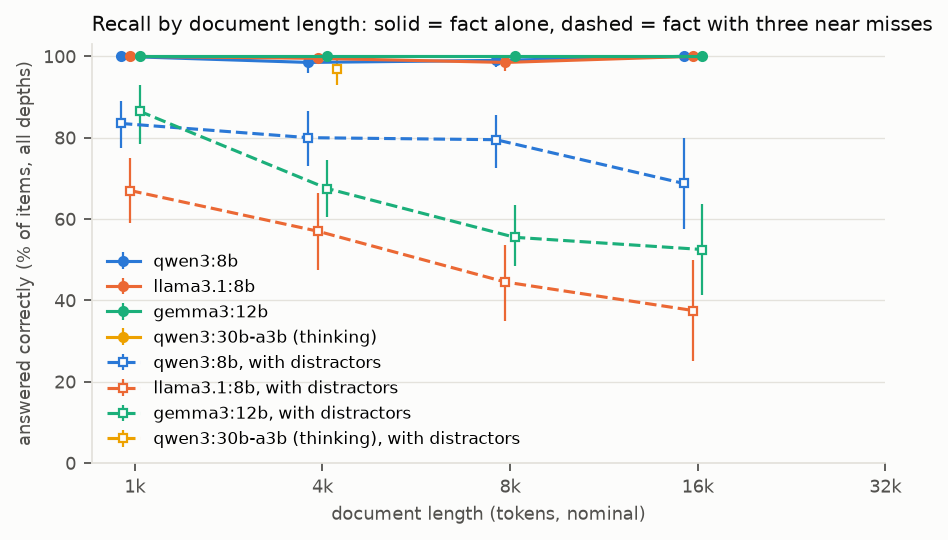
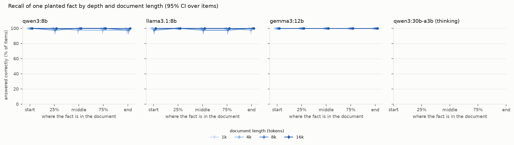
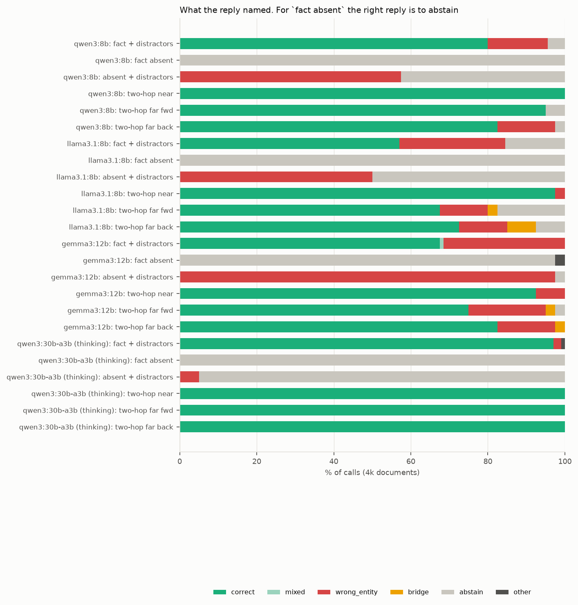

# Results

Generated by `uv run lcrecall report` from `results/rows/*.jsonl` and `data/items.jsonl`. Every number below is computed by code from cached model outputs, re-checked with the current answer checker. Intervals are 95% percentile bootstraps (2,000 resamples) over items: every cell of an item holds the same fictional fact, so an item's cells move together and differences between cells are paired by item. `pp` = percentage points; `*` marks a difference whose interval excludes zero.

## Headline

- **qwen3:8b**, recall over all depths, fact alone: 1k 100% [100, 100]; 4k 98% [96, 100]; 8k 99% [98, 100]; 16k 100% [100, 100]. with distractors: 1k 84% [78, 89]; 4k 80% [73, 86]; 8k 80% [72, 86]; 16k 69% [57, 80]. Two-hop at 4k: adjacent 100% [100, 100], far 95% [88, 100] / 82% [70, 92]. A/A flip rate 0.0% [0.0, 0.0].
- **llama3.1:8b**, recall over all depths, fact alone: 1k 100% [100, 100]; 4k 99% [98, 100]; 8k 98% [97, 100]; 16k 100% [100, 100]. with distractors: 1k 67% [59, 75]; 4k 57% [48, 66]; 8k 44% [35, 54]; 16k 38% [25, 50]. Two-hop at 4k: adjacent 98% [92, 100], far 68% [52, 82] / 72% [57, 85]. A/A flip rate 0.0% [0.0, 0.0].
- **gemma3:12b**, recall over all depths, fact alone: 1k 100% [100, 100]; 4k 100% [100, 100]; 8k 100% [100, 100]; 16k 100% [100, 100]. with distractors: 1k 86% [78, 93]; 4k 68% [61, 74]; 8k 56% [48, 64]; 16k 52% [41, 64]. Two-hop at 4k: adjacent 92% [82, 100], far 75% [60, 88] / 82% [70, 92]. A/A flip rate 0.5% [0.0, 1.5].
- **qwen3:30b-a3b (thinking)**, recall over all depths, with distractors: 4k 97% [93, 100]. Two-hop at 4k: adjacent 100% [100, 100], far 100% [100, 100] / 100% [100, 100].

## 1. Setup and token check

Every call uses num_ctx 33,792. `ratio` = the server's prompt_eval_count over the estimate (characters / chars-per-token + template tokens); a call outside [0.7, 1.4] or over num_ctx would have stopped the run (Ollama shortens an over-long prompt silently), so every row below passed. `wall` = median seconds per call, including prefix reuse within an item.

| model | digest | length | calls | items | mean prompt tokens | max | ratio | median wall s/call | median prefill tok/s | output tokens | thinking chars | hit answer cap |
|---|---|---|---|---|---|---|---|---|---|---|---|---|
| qwen3:8b | 500a1f067a9f | closed | 80 | 40 | 60 | 63 | 0.97 to 1.05 | 0.1 | 662 | 2 | 0 | 0.0% |
| qwen3:8b | 500a1f067a9f | 1k | 470 | 40 | 1,064 | 1,236 | 0.88 to 1.11 | 0.8 | 1,514 | 6 | 0 | 0.0% |
| qwen3:8b | 500a1f067a9f | 4k | 705 | 40 | 3,700 | 4,092 | 0.86 to 1.08 | 3.0 | 1,296 | 5 | 0 | 0.0% |
| qwen3:8b | 500a1f067a9f | 8k | 465 | 40 | 7,231 | 7,793 | 0.87 to 1.05 | 5.0 | 1,521 | 6 | 0 | 0.0% |
| qwen3:8b | 500a1f067a9f | 16k | 240 | 20 | 14,221 | 15,339 | 0.89 to 1.05 | 15.5 | 923 | 5 | 0 | 0.0% |
| llama3.1:8b | 46e0c10c039e | closed | 80 | 40 | 54 | 57 | 0.98 to 1.08 | 0.1 | 620 | 2 | 0 | 0.0% |
| llama3.1:8b | 46e0c10c039e | 1k | 470 | 40 | 1,020 | 1,201 | 0.88 to 1.10 | 0.8 | 1,490 | 6 | 0 | 0.0% |
| llama3.1:8b | 46e0c10c039e | 4k | 705 | 40 | 3,581 | 3,943 | 0.86 to 1.06 | 2.9 | 1,282 | 5 | 0 | 0.0% |
| llama3.1:8b | 46e0c10c039e | 8k | 465 | 40 | 7,011 | 7,628 | 0.87 to 1.05 | 4.8 | 1,520 | 6 | 0 | 0.0% |
| llama3.1:8b | 46e0c10c039e | 16k | 240 | 20 | 13,782 | 14,843 | 0.89 to 1.04 | 14.2 | 985 | 5 | 0 | 0.0% |
| gemma3:12b | b92b218582c5 | closed | 80 | 40 | 55 | 57 | 0.96 to 1.06 | 0.3 | 300 | 4 | 0 | 0.0% |
| gemma3:12b | b92b218582c5 | 1k | 470 | 40 | 1,043 | 1,193 | 0.85 to 1.11 | 1.7 | 672 | 6 | 0 | 0.0% |
| gemma3:12b | b92b218582c5 | 4k | 705 | 40 | 3,621 | 4,085 | 0.86 to 1.08 | 5.6 | 666 | 5 | 0 | 0.0% |
| gemma3:12b | b92b218582c5 | 8k | 465 | 40 | 7,075 | 7,648 | 0.87 to 1.04 | 10.6 | 660 | 5 | 0 | 0.0% |
| gemma3:12b | b92b218582c5 | 16k | 240 | 20 | 13,965 | 15,147 | 0.88 to 1.04 | 22.4 | 631 | 5 | 0 | 0.0% |
| qwen3:30b-a3b (thinking) | ad815644918f | closed | 40 | 20 | 54 | 56 | 0.93 to 1.00 | 4.0 | 588 | 322 | 1,366 | 0.0% |
| qwen3:30b-a3b (thinking) | ad815644918f | 4k | 220 | 20 | 3,727 | 4,086 | 0.86 to 1.08 | 6.7 | 1,480 | 323 | 1,270 | 0.5% |

## 2. Closed-book control

The question with no document. Every answer is invented, so a correct reply here would mean the answer leaked into the question or the model guessed it.

| model | question | calls | correct | abstain | near-miss name | other name |
|---|---|---|---|---|---|---|
| qwen3:8b | key question | 40 | 0% [0, 0] | 100% [100, 100] | 0% [0, 0] | 0% [0, 0] |
| qwen3:8b | second-hop question | 40 | 0% [0, 0] | 100% [100, 100] | 0% [0, 0] | 0% [0, 0] |
| llama3.1:8b | key question | 40 | 0% [0, 0] | 98% [92, 100] | 0% [0, 0] | 2% [0, 8] |
| llama3.1:8b | second-hop question | 40 | 0% [0, 0] | 95% [88, 100] | 0% [0, 0] | 5% [0, 12] |
| gemma3:12b | key question | 40 | 0% [0, 0] | 32% [18, 48] | 0% [0, 0] | 68% [52, 82] |
| gemma3:12b | second-hop question | 40 | 0% [0, 0] | 18% [8, 30] | 0% [0, 0] | 82% [70, 92] |
| qwen3:30b-a3b (thinking) | key question | 20 | 0% [0, 0] | 100% [100, 100] | 0% [0, 0] | 0% [0, 0] |
| qwen3:30b-a3b (thinking) | second-hop question | 20 | 0% [0, 0] | 95% [85, 100] | 0% [0, 0] | 5% [0, 15] |

## 3. Recall by length and depth

Share of items answered correctly with the key fact at each depth, alone and with the three near-miss distractors. `all` averages an item's five depths.






**qwen3:8b, fact alone**

| length | items | start | 25% | middle | 75% | end | all |
|---|---|---|---|---|---|---|---|
| 1k | 40 | 100% [100, 100] | 100% [100, 100] | 100% [100, 100] | 100% [100, 100] | 100% [100, 100] | 100% [100, 100] |
| 4k | 40 | 100% [100, 100] | 100% [100, 100] | 98% [92, 100] | 98% [92, 100] | 98% [92, 100] | 98% [96, 100] |
| 8k | 40 | 100% [100, 100] | 98% [92, 100] | 100% [100, 100] | 100% [100, 100] | 98% [92, 100] | 99% [98, 100] |
| 16k | 16 | 100% [100, 100] | 100% [100, 100] | 100% [100, 100] | 100% [100, 100] | 100% [100, 100] | 100% [100, 100] |

**qwen3:8b, with distractors**

| length | items | start | 25% | middle | 75% | end | all |
|---|---|---|---|---|---|---|---|
| 1k | 40 | 88% [77, 98] | 98% [92, 100] | 85% [72, 95] | 65% [50, 80] | 82% [70, 92] | 84% [78, 89] |
| 4k | 40 | 90% [80, 98] | 80% [68, 92] | 78% [65, 90] | 68% [52, 82] | 85% [72, 95] | 80% [73, 86] |
| 8k | 40 | 95% [88, 100] | 80% [68, 92] | 68% [52, 80] | 60% [45, 75] | 95% [88, 100] | 80% [72, 86] |
| 16k | 16 | 100% [100, 100] | 44% [19, 69] | 62% [38, 88] | 38% [12, 62] | 100% [100, 100] | 69% [57, 80] |

**llama3.1:8b, fact alone**

| length | items | start | 25% | middle | 75% | end | all |
|---|---|---|---|---|---|---|---|
| 1k | 40 | 100% [100, 100] | 100% [100, 100] | 100% [100, 100] | 100% [100, 100] | 100% [100, 100] | 100% [100, 100] |
| 4k | 40 | 100% [100, 100] | 100% [100, 100] | 100% [100, 100] | 100% [100, 100] | 98% [92, 100] | 99% [98, 100] |
| 8k | 40 | 98% [92, 100] | 100% [100, 100] | 98% [92, 100] | 98% [92, 100] | 100% [100, 100] | 98% [97, 100] |
| 16k | 16 | 100% [100, 100] | 100% [100, 100] | 100% [100, 100] | 100% [100, 100] | 100% [100, 100] | 100% [100, 100] |

**llama3.1:8b, with distractors**

| length | items | start | 25% | middle | 75% | end | all |
|---|---|---|---|---|---|---|---|
| 1k | 40 | 92% [85, 100] | 85% [72, 95] | 57% [42, 72] | 50% [35, 65] | 50% [35, 65] | 67% [59, 75] |
| 4k | 40 | 65% [50, 80] | 62% [48, 78] | 52% [38, 68] | 55% [40, 70] | 50% [35, 65] | 57% [48, 66] |
| 8k | 40 | 57% [42, 72] | 60% [45, 75] | 45% [30, 60] | 28% [15, 42] | 32% [18, 48] | 44% [35, 54] |
| 16k | 16 | 38% [12, 62] | 44% [19, 69] | 62% [38, 88] | 19% [0, 38] | 25% [6, 50] | 38% [25, 50] |

**gemma3:12b, fact alone**

| length | items | start | 25% | middle | 75% | end | all |
|---|---|---|---|---|---|---|---|
| 1k | 40 | 100% [100, 100] | 100% [100, 100] | 100% [100, 100] | 100% [100, 100] | 100% [100, 100] | 100% [100, 100] |
| 4k | 40 | 100% [100, 100] | 100% [100, 100] | 100% [100, 100] | 100% [100, 100] | 100% [100, 100] | 100% [100, 100] |
| 8k | 40 | 100% [100, 100] | 100% [100, 100] | 100% [100, 100] | 100% [100, 100] | 100% [100, 100] | 100% [100, 100] |
| 16k | 16 | 100% [100, 100] | 100% [100, 100] | 100% [100, 100] | 100% [100, 100] | 100% [100, 100] | 100% [100, 100] |

**gemma3:12b, with distractors**

| length | items | start | 25% | middle | 75% | end | all |
|---|---|---|---|---|---|---|---|
| 1k | 40 | 95% [88, 100] | 98% [92, 100] | 82% [70, 92] | 78% [65, 90] | 80% [68, 90] | 86% [78, 93] |
| 4k | 40 | 100% [100, 100] | 82% [70, 92] | 40% [25, 55] | 45% [30, 60] | 70% [55, 82] | 68% [61, 74] |
| 8k | 40 | 95% [88, 100] | 50% [35, 65] | 25% [12, 40] | 40% [25, 55] | 68% [52, 80] | 56% [48, 64] |
| 16k | 16 | 88% [69, 100] | 62% [38, 88] | 12% [0, 31] | 44% [19, 69] | 56% [31, 81] | 52% [41, 64] |

**qwen3:30b-a3b (thinking), with distractors**

| length | items | start | 25% | middle | 75% | end | all |
|---|---|---|---|---|---|---|---|
| 4k | 20 | 100% [100, 100] | 100% [100, 100] | 95% [85, 100] | 95% [85, 100] | 95% [85, 100] | 97% [93, 100] |

## 4. Effect of length

Accuracy over all depths at each length minus at 1k, paired by item (the longer document contains the shorter one as its first part).

| model | condition | 4k minus 1k | 8k minus 1k | 16k minus 1k | 32k minus 1k |
|---|---|---|---|---|---|
| qwen3:8b | fact alone | -1.5 pp [-4.0, +0.0] | -1.0 pp [-2.5, +0.0] | +0.0 pp [+0.0, +0.0] | n/a |
| qwen3:8b | with distractors | -3.5 pp [-10.5, +3.0] | -4.0 pp [-11.5, +3.0] | -13.8 pp [-26.2, -1.3] * | n/a |
| llama3.1:8b | fact alone | -0.5 pp [-1.5, +0.0] | -1.5 pp [-3.5, +0.0] | +0.0 pp [+0.0, +0.0] | n/a |
| llama3.1:8b | with distractors | -10.0 pp [-20.0, -1.5] * | -22.5 pp [-31.5, -13.5] * | -25.0 pp [-37.5, -11.2] * | n/a |
| gemma3:12b | fact alone | +0.0 pp [+0.0, +0.0] | +0.0 pp [+0.0, +0.0] | +0.0 pp [+0.0, +0.0] | n/a |
| gemma3:12b | with distractors | -19.0 pp [-26.0, -11.0] * | -31.0 pp [-39.5, -22.0] * | -27.5 pp [-40.0, -15.0] * | n/a |
| qwen3:30b-a3b (thinking) | with distractors | n/a | n/a | n/a | n/a |

## 5. Effect of position

Middle minus ends = accuracy with the fact in the middle minus the mean of start and end; interior minus ends uses the mean of 25%, 50% and 75%; start minus end compares the two edges. Paired by item. `1k-8k` pools 1k, 4k and 8k (an item's lengths averaged); `16k-32k` pools whatever ran.

| model | fact | lengths | items | middle minus ends | interior minus ends | start minus end | worst depth |
|---|---|---|---|---|---|---|---|
| qwen3:8b | alone | 1k | 40 | +0.0 pp [+0.0, +0.0] | +0.0 pp [+0.0, +0.0] | +0.0 pp [+0.0, +0.0] | start (100%) |
| qwen3:8b | alone | 4k | 40 | -1.2 pp [-7.5, +3.8] | -0.4 pp [-2.5, +1.2] | +2.5 pp [+0.0, +7.5] | middle (98%) |
| qwen3:8b | alone | 8k | 40 | +1.2 pp [+0.0, +3.8] | +0.4 pp [-2.5, +3.8] | +2.5 pp [+0.0, +7.5] | 25% (98%) |
| qwen3:8b | alone | 16k | 16 | +0.0 pp [+0.0, +0.0] | +0.0 pp [+0.0, +0.0] | +0.0 pp [+0.0, +0.0] | start (100%) |
| qwen3:8b | alone | 1k-8k | 40 | +0.0 pp [-2.5, +2.5] | -0.0 pp [-1.7, +1.7] | +1.7 pp [+0.0, +5.0] | end (98%) |
| qwen3:8b | alone | 16k-32k | 16 | +0.0 pp [+0.0, +0.0] | +0.0 pp [+0.0, +0.0] | +0.0 pp [+0.0, +0.0] | start (100%) |
| qwen3:8b | distractors | 1k | 40 | +0.0 pp [-11.2, +11.2] | -2.5 pp [-10.4, +5.4] | +5.0 pp [-10.0, +20.0] | 75% (65%) |
| qwen3:8b | distractors | 4k | 40 | -10.0 pp [-25.0, +5.0] | -12.5 pp [-23.3, -2.1] * | +5.0 pp [-10.0, +20.0] | 75% (68%) |
| qwen3:8b | distractors | 8k | 40 | -27.5 pp [-42.5, -12.5] * | -25.8 pp [-37.1, -15.8] * | +0.0 pp [-10.0, +10.0] | 75% (60%) |
| qwen3:8b | distractors | 16k | 16 | -37.5 pp [-62.5, -12.5] * | -52.1 pp [-70.8, -33.3] * | +0.0 pp [+0.0, +0.0] | 75% (38%) |
| qwen3:8b | distractors | 1k-8k | 40 | -12.5 pp [-21.7, -4.2] * | -13.6 pp [-19.9, -7.8] * | +3.3 pp [-6.7, +13.3] | 75% (64%) |
| qwen3:8b | distractors | 16k-32k | 16 | -37.5 pp [-62.5, -12.5] * | -52.1 pp [-70.8, -33.3] * | +0.0 pp [+0.0, +0.0] | 75% (38%) |
| llama3.1:8b | alone | 1k | 40 | +0.0 pp [+0.0, +0.0] | +0.0 pp [+0.0, +0.0] | +0.0 pp [+0.0, +0.0] | start (100%) |
| llama3.1:8b | alone | 4k | 40 | +1.2 pp [+0.0, +3.8] | +1.2 pp [+0.0, +3.8] | +2.5 pp [+0.0, +7.5] | end (98%) |
| llama3.1:8b | alone | 8k | 40 | -1.2 pp [-7.5, +3.8] | -0.4 pp [-3.3, +2.9] | -2.5 pp [-7.5, +0.0] | start (98%) |
| llama3.1:8b | alone | 16k | 16 | +0.0 pp [+0.0, +0.0] | +0.0 pp [+0.0, +0.0] | +0.0 pp [+0.0, +0.0] | start (100%) |
| llama3.1:8b | alone | 1k-8k | 40 | +0.0 pp [-1.2, +1.3] | +0.3 pp [-0.7, +1.4] | +0.0 pp [-2.5, +2.5] | start (99%) |
| llama3.1:8b | alone | 16k-32k | 16 | +0.0 pp [+0.0, +0.0] | +0.0 pp [+0.0, +0.0] | +0.0 pp [+0.0, +0.0] | start (100%) |
| llama3.1:8b | distractors | 1k | 40 | -13.8 pp [-30.0, +2.5] | -7.1 pp [-18.3, +4.2] | +42.5 pp [+25.0, +60.0] * | 75% (50%) |
| llama3.1:8b | distractors | 4k | 40 | -5.0 pp [-18.8, +8.8] | -0.8 pp [-13.8, +10.8] | +15.0 pp [-5.0, +37.5] | end (50%) |
| llama3.1:8b | distractors | 8k | 40 | +0.0 pp [-13.8, +15.0] | -0.8 pp [-10.4, +8.7] | +25.0 pp [+5.0, +47.5] * | 75% (28%) |
| llama3.1:8b | distractors | 16k | 16 | +31.2 pp [+0.0, +62.5] | +10.4 pp [-7.3, +30.2] | +12.5 pp [-18.8, +43.8] | 75% (19%) |
| llama3.1:8b | distractors | 1k-8k | 40 | -6.2 pp [-16.2, +3.8] | -2.9 pp [-10.8, +5.1] | +27.5 pp [+13.3, +42.5] * | 75% (44%) |
| llama3.1:8b | distractors | 16k-32k | 16 | +31.2 pp [+0.0, +62.5] | +10.4 pp [-7.3, +30.2] | +12.5 pp [-18.8, +43.8] | 75% (19%) |
| gemma3:12b | alone | 1k | 40 | +0.0 pp [+0.0, +0.0] | +0.0 pp [+0.0, +0.0] | +0.0 pp [+0.0, +0.0] | start (100%) |
| gemma3:12b | alone | 4k | 40 | +0.0 pp [+0.0, +0.0] | +0.0 pp [+0.0, +0.0] | +0.0 pp [+0.0, +0.0] | start (100%) |
| gemma3:12b | alone | 8k | 40 | +0.0 pp [+0.0, +0.0] | +0.0 pp [+0.0, +0.0] | +0.0 pp [+0.0, +0.0] | start (100%) |
| gemma3:12b | alone | 16k | 16 | +0.0 pp [+0.0, +0.0] | +0.0 pp [+0.0, +0.0] | +0.0 pp [+0.0, +0.0] | start (100%) |
| gemma3:12b | alone | 1k-8k | 40 | +0.0 pp [+0.0, +0.0] | +0.0 pp [+0.0, +0.0] | +0.0 pp [+0.0, +0.0] | start (100%) |
| gemma3:12b | alone | 16k-32k | 16 | +0.0 pp [+0.0, +0.0] | +0.0 pp [+0.0, +0.0] | +0.0 pp [+0.0, +0.0] | start (100%) |
| gemma3:12b | distractors | 1k | 40 | -5.0 pp [-13.8, +2.5] | -1.7 pp [-6.2, +2.9] | +15.0 pp [+2.5, +27.5] * | 75% (78%) |
| gemma3:12b | distractors | 4k | 40 | -45.0 pp [-61.3, -28.7] * | -29.2 pp [-40.4, -17.9] * | +30.0 pp [+17.5, +45.0] * | middle (40%) |
| gemma3:12b | distractors | 8k | 40 | -56.2 pp [-71.2, -40.0] * | -42.9 pp [-56.7, -29.2] * | +27.5 pp [+12.5, +42.5] * | middle (25%) |
| gemma3:12b | distractors | 16k | 16 | -59.4 pp [-81.2, -34.4] * | -32.3 pp [-53.1, -10.4] * | +31.2 pp [+12.5, +56.2] * | middle (12%) |
| gemma3:12b | distractors | 1k-8k | 40 | -35.4 pp [-43.8, -26.7] * | -24.6 pp [-31.4, -17.5] * | +24.2 pp [+15.0, +33.3] * | middle (49%) |
| gemma3:12b | distractors | 16k-32k | 16 | -59.4 pp [-81.2, -34.4] * | -32.3 pp [-53.1, -10.4] * | +31.2 pp [+12.5, +56.2] * | middle (12%) |
| qwen3:30b-a3b (thinking) | distractors | 4k | 20 | -2.5 pp [-15.0, +7.5] | -0.8 pp [-6.7, +5.9] | +5.0 pp [+0.0, +15.0] | middle (95%) |
| qwen3:30b-a3b (thinking) | distractors | 1k-8k | 20 | -2.5 pp [-15.0, +7.5] | -0.8 pp [-6.7, +5.9] | +5.0 pp [+0.0, +15.0] | middle (95%) |

## 6. Near-miss distractors and missing facts

Three near-miss facts (the same name with another type of entity, the same type with the name's ending changed, the same type with its beginning changed), each naming a different person, at seeded depths away from the key positions. Effect = accuracy with distractors minus without, same items and depths. Fact absent (at 4k): the key fact is left out, so the right reply is `not stated`.



| model | length | depth | items | without distractors | with distractors | effect |
|---|---|---|---|---|---|---|
| qwen3:8b | 1k | all | 40 | 100% [100, 100] | 84% [78, 89] | -16.5 pp [-22.5, -11.0] * |
| qwen3:8b | 1k | start | 40 | 100% [100, 100] | 88% [77, 98] | -12.5 pp [-22.6, -2.5] * |
| qwen3:8b | 1k | 25% | 40 | 100% [100, 100] | 98% [92, 100] | -2.5 pp [-7.5, +0.0] |
| qwen3:8b | 1k | middle | 40 | 100% [100, 100] | 85% [72, 95] | -15.0 pp [-27.5, -5.0] * |
| qwen3:8b | 1k | 75% | 40 | 100% [100, 100] | 65% [50, 80] | -35.0 pp [-50.0, -20.0] * |
| qwen3:8b | 1k | end | 40 | 100% [100, 100] | 82% [70, 92] | -17.5 pp [-30.0, -7.5] * |
| qwen3:8b | 4k | all | 40 | 98% [96, 100] | 80% [73, 86] | -18.5 pp [-26.0, -11.5] * |
| qwen3:8b | 4k | start | 40 | 100% [100, 100] | 90% [80, 98] | -10.0 pp [-20.0, -2.5] * |
| qwen3:8b | 4k | 25% | 40 | 100% [100, 100] | 80% [68, 92] | -20.0 pp [-32.5, -7.5] * |
| qwen3:8b | 4k | middle | 40 | 98% [92, 100] | 78% [65, 90] | -20.0 pp [-32.5, -7.5] * |
| qwen3:8b | 4k | 75% | 40 | 98% [92, 100] | 68% [52, 82] | -30.0 pp [-45.0, -15.0] * |
| qwen3:8b | 4k | end | 40 | 98% [92, 100] | 85% [72, 95] | -12.5 pp [-25.0, +0.0] |
| qwen3:8b | 8k | all | 40 | 99% [98, 100] | 80% [72, 86] | -19.5 pp [-26.5, -13.0] * |
| qwen3:8b | 8k | start | 40 | 100% [100, 100] | 95% [88, 100] | -5.0 pp [-12.5, +0.0] |
| qwen3:8b | 8k | 25% | 40 | 98% [92, 100] | 80% [68, 92] | -17.5 pp [-30.0, -7.5] * |
| qwen3:8b | 8k | middle | 40 | 100% [100, 100] | 68% [52, 80] | -32.5 pp [-47.5, -20.0] * |
| qwen3:8b | 8k | 75% | 40 | 100% [100, 100] | 60% [45, 75] | -40.0 pp [-55.0, -25.0] * |
| qwen3:8b | 8k | end | 40 | 98% [92, 100] | 95% [88, 100] | -2.5 pp [-10.0, +5.0] |
| qwen3:8b | 16k | all | 16 | 100% [100, 100] | 69% [57, 80] | -31.2 pp [-42.5, -20.0] * |
| qwen3:8b | 16k | start | 16 | 100% [100, 100] | 100% [100, 100] | +0.0 pp [+0.0, +0.0] |
| qwen3:8b | 16k | 25% | 16 | 100% [100, 100] | 44% [19, 69] | -56.2 pp [-81.2, -31.2] * |
| qwen3:8b | 16k | middle | 16 | 100% [100, 100] | 62% [38, 88] | -37.5 pp [-62.5, -12.5] * |
| qwen3:8b | 16k | 75% | 16 | 100% [100, 100] | 38% [12, 62] | -62.5 pp [-87.5, -37.5] * |
| qwen3:8b | 16k | end | 16 | 100% [100, 100] | 100% [100, 100] | +0.0 pp [+0.0, +0.0] |
| llama3.1:8b | 1k | all | 40 | 100% [100, 100] | 67% [59, 75] | -33.0 pp [-41.0, -25.0] * |
| llama3.1:8b | 1k | start | 40 | 100% [100, 100] | 92% [85, 100] | -7.5 pp [-15.0, +0.0] |
| llama3.1:8b | 1k | 25% | 40 | 100% [100, 100] | 85% [72, 95] | -15.0 pp [-27.5, -5.0] * |
| llama3.1:8b | 1k | middle | 40 | 100% [100, 100] | 57% [42, 72] | -42.5 pp [-57.5, -27.5] * |
| llama3.1:8b | 1k | 75% | 40 | 100% [100, 100] | 50% [35, 65] | -50.0 pp [-65.0, -35.0] * |
| llama3.1:8b | 1k | end | 40 | 100% [100, 100] | 50% [35, 65] | -50.0 pp [-65.0, -35.0] * |
| llama3.1:8b | 4k | all | 40 | 99% [98, 100] | 57% [48, 66] | -42.5 pp [-52.0, -33.0] * |
| llama3.1:8b | 4k | start | 40 | 100% [100, 100] | 65% [50, 80] | -35.0 pp [-50.0, -20.0] * |
| llama3.1:8b | 4k | 25% | 40 | 100% [100, 100] | 62% [48, 78] | -37.5 pp [-52.5, -22.5] * |
| llama3.1:8b | 4k | middle | 40 | 100% [100, 100] | 52% [38, 68] | -47.5 pp [-62.5, -32.5] * |
| llama3.1:8b | 4k | 75% | 40 | 100% [100, 100] | 55% [40, 70] | -45.0 pp [-60.0, -30.0] * |
| llama3.1:8b | 4k | end | 40 | 98% [92, 100] | 50% [35, 65] | -47.5 pp [-62.5, -32.5] * |
| llama3.1:8b | 8k | all | 40 | 98% [97, 100] | 44% [35, 54] | -54.0 pp [-63.5, -45.0] * |
| llama3.1:8b | 8k | start | 40 | 98% [92, 100] | 57% [42, 72] | -40.0 pp [-57.5, -22.5] * |
| llama3.1:8b | 8k | 25% | 40 | 100% [100, 100] | 60% [45, 75] | -40.0 pp [-55.0, -25.0] * |
| llama3.1:8b | 8k | middle | 40 | 98% [92, 100] | 45% [30, 60] | -52.5 pp [-67.5, -37.5] * |
| llama3.1:8b | 8k | 75% | 40 | 98% [92, 100] | 28% [15, 42] | -70.0 pp [-85.0, -52.5] * |
| llama3.1:8b | 8k | end | 40 | 100% [100, 100] | 32% [18, 48] | -67.5 pp [-82.5, -52.5] * |
| llama3.1:8b | 16k | all | 16 | 100% [100, 100] | 38% [25, 50] | -62.5 pp [-75.0, -50.0] * |
| llama3.1:8b | 16k | start | 16 | 100% [100, 100] | 38% [12, 62] | -62.5 pp [-87.5, -37.5] * |
| llama3.1:8b | 16k | 25% | 16 | 100% [100, 100] | 44% [19, 69] | -56.2 pp [-81.2, -31.2] * |
| llama3.1:8b | 16k | middle | 16 | 100% [100, 100] | 62% [38, 88] | -37.5 pp [-62.5, -12.5] * |
| llama3.1:8b | 16k | 75% | 16 | 100% [100, 100] | 19% [0, 38] | -81.2 pp [-100.0, -62.5] * |
| llama3.1:8b | 16k | end | 16 | 100% [100, 100] | 25% [6, 50] | -75.0 pp [-93.8, -50.0] * |
| gemma3:12b | 1k | all | 40 | 100% [100, 100] | 86% [78, 93] | -13.5 pp [-21.5, -7.0] * |
| gemma3:12b | 1k | start | 40 | 100% [100, 100] | 95% [88, 100] | -5.0 pp [-12.5, +0.0] |
| gemma3:12b | 1k | 25% | 40 | 100% [100, 100] | 98% [92, 100] | -2.5 pp [-7.5, +0.0] |
| gemma3:12b | 1k | middle | 40 | 100% [100, 100] | 82% [70, 92] | -17.5 pp [-30.0, -7.5] * |
| gemma3:12b | 1k | 75% | 40 | 100% [100, 100] | 78% [65, 90] | -22.5 pp [-35.0, -10.0] * |
| gemma3:12b | 1k | end | 40 | 100% [100, 100] | 80% [68, 90] | -20.0 pp [-32.5, -10.0] * |
| gemma3:12b | 4k | all | 40 | 100% [100, 100] | 68% [61, 74] | -32.5 pp [-39.5, -25.5] * |
| gemma3:12b | 4k | start | 40 | 100% [100, 100] | 100% [100, 100] | +0.0 pp [+0.0, +0.0] |
| gemma3:12b | 4k | 25% | 40 | 100% [100, 100] | 82% [70, 92] | -17.5 pp [-30.0, -7.5] * |
| gemma3:12b | 4k | middle | 40 | 100% [100, 100] | 40% [25, 55] | -60.0 pp [-75.0, -45.0] * |
| gemma3:12b | 4k | 75% | 40 | 100% [100, 100] | 45% [30, 60] | -55.0 pp [-70.0, -40.0] * |
| gemma3:12b | 4k | end | 40 | 100% [100, 100] | 70% [55, 82] | -30.0 pp [-45.0, -17.5] * |
| gemma3:12b | 8k | all | 40 | 100% [100, 100] | 56% [48, 64] | -44.5 pp [-51.5, -36.5] * |
| gemma3:12b | 8k | start | 40 | 100% [100, 100] | 95% [88, 100] | -5.0 pp [-12.5, +0.0] |
| gemma3:12b | 8k | 25% | 40 | 100% [100, 100] | 50% [35, 65] | -50.0 pp [-65.0, -35.0] * |
| gemma3:12b | 8k | middle | 40 | 100% [100, 100] | 25% [12, 40] | -75.0 pp [-87.5, -60.0] * |
| gemma3:12b | 8k | 75% | 40 | 100% [100, 100] | 40% [25, 55] | -60.0 pp [-75.0, -45.0] * |
| gemma3:12b | 8k | end | 40 | 100% [100, 100] | 68% [52, 80] | -32.5 pp [-47.5, -20.0] * |
| gemma3:12b | 16k | all | 16 | 100% [100, 100] | 52% [41, 64] | -47.5 pp [-58.8, -36.2] * |
| gemma3:12b | 16k | start | 16 | 100% [100, 100] | 88% [69, 100] | -12.5 pp [-31.2, +0.0] |
| gemma3:12b | 16k | 25% | 16 | 100% [100, 100] | 62% [38, 88] | -37.5 pp [-62.5, -12.5] * |
| gemma3:12b | 16k | middle | 16 | 100% [100, 100] | 12% [0, 31] | -87.5 pp [-100.0, -68.8] * |
| gemma3:12b | 16k | 75% | 16 | 100% [100, 100] | 44% [19, 69] | -56.2 pp [-81.2, -31.2] * |
| gemma3:12b | 16k | end | 16 | 100% [100, 100] | 56% [31, 81] | -43.8 pp [-68.8, -18.8] * |
| qwen3:30b-a3b (thinking) | 4k | all | 20 | n/a | 97% [93, 100] | n/a |
| qwen3:30b-a3b (thinking) | 4k | start | 20 | n/a | 100% [100, 100] | n/a |
| qwen3:30b-a3b (thinking) | 4k | 25% | 20 | n/a | 100% [100, 100] | n/a |
| qwen3:30b-a3b (thinking) | 4k | middle | 20 | n/a | 95% [85, 100] | n/a |
| qwen3:30b-a3b (thinking) | 4k | 75% | 20 | n/a | 95% [85, 100] | n/a |
| qwen3:30b-a3b (thinking) | 4k | end | 20 | n/a | 95% [85, 100] | n/a |

Outcome shares (`wrong_entity` = named a distractor's person):

| model | length | condition | calls | correct | mixed | wrong_entity | bridge | abstain | other | near misses picked (calls) |
|---|---|---|---|---|---|---|---|---|---|---|
| qwen3:8b | 1k | fact + distractors | 200 | 84% [78, 89] | 0% [0, 0] | 13% [8, 18] | 0% [0, 0] | 3% [1, 7] | 0% [0, 0] | same_stem 24, same_prefix 1, same_suffix 1 |
| qwen3:8b | 4k | fact + distractors | 200 | 80% [73, 86] | 0% [0, 0] | 16% [9, 22] | 0% [0, 0] | 4% [2, 8] | 0% [0, 0] | same_stem 18, same_prefix 5, same_suffix 8 |
| qwen3:8b | 4k | fact absent | 40 | 0% [0, 0] | 0% [0, 0] | 0% [0, 0] | 0% [0, 0] | 100% [100, 100] | 0% [0, 0] |  |
| qwen3:8b | 4k | fact absent + distractors | 40 | 0% [0, 0] | 0% [0, 0] | 57% [42, 72] | 0% [0, 0] | 42% [28, 57] | 0% [0, 0] |  |
| qwen3:8b | 8k | fact + distractors | 200 | 80% [72, 86] | 0% [0, 0] | 15% [10, 22] | 0% [0, 0] | 6% [2, 10] | 0% [0, 0] | same_stem 17, same_prefix 3, same_suffix 10 |
| qwen3:8b | 16k | fact + distractors | 80 | 69% [57, 80] | 0% [0, 0] | 15% [8, 24] | 0% [0, 0] | 16% [6, 28] | 0% [0, 0] | same_stem 5, same_prefix 3, same_suffix 4 |
| llama3.1:8b | 1k | fact + distractors | 200 | 67% [59, 75] | 0% [0, 0] | 17% [11, 24] | 0% [0, 0] | 16% [10, 22] | 0% [0, 0] | same_stem 27, same_prefix 2, same_suffix 5 |
| llama3.1:8b | 4k | fact + distractors | 200 | 57% [48, 66] | 0% [0, 0] | 28% [20, 36] | 0% [0, 0] | 16% [9, 22] | 0% [0, 0] | same_stem 44, same_prefix 6, same_suffix 5 |
| llama3.1:8b | 4k | fact absent | 40 | 0% [0, 0] | 0% [0, 0] | 0% [0, 0] | 0% [0, 0] | 100% [100, 100] | 0% [0, 0] |  |
| llama3.1:8b | 4k | fact absent + distractors | 40 | 0% [0, 0] | 0% [0, 0] | 50% [35, 65] | 0% [0, 0] | 50% [35, 65] | 0% [0, 0] |  |
| llama3.1:8b | 8k | fact + distractors | 200 | 44% [35, 54] | 0% [0, 0] | 37% [28, 46] | 0% [0, 0] | 18% [10, 28] | 0% [0, 0] | same_stem 62, same_prefix 7, same_suffix 5 |
| llama3.1:8b | 16k | fact + distractors | 80 | 38% [25, 50] | 0% [0, 0] | 41% [32, 50] | 0% [0, 0] | 21% [12, 31] | 0% [0, 0] | same_stem 19, same_prefix 10, same_suffix 4 |
| gemma3:12b | 1k | fact + distractors | 200 | 86% [78, 93] | 0% [0, 2] | 13% [6, 21] | 0% [0, 0] | 0% [0, 0] | 0% [0, 0] | same_stem 20, same_prefix 4, same_suffix 3 |
| gemma3:12b | 4k | fact + distractors | 200 | 68% [61, 74] | 1% [0, 2] | 32% [25, 38] | 0% [0, 0] | 0% [0, 0] | 0% [0, 0] | same_stem 41, same_prefix 9, same_suffix 17 |
| gemma3:12b | 4k | fact absent | 40 | 0% [0, 0] | 0% [0, 0] | 0% [0, 0] | 0% [0, 0] | 98% [92, 100] | 2% [0, 8] |  |
| gemma3:12b | 4k | fact absent + distractors | 40 | 0% [0, 0] | 0% [0, 0] | 98% [92, 100] | 0% [0, 0] | 2% [0, 8] | 0% [0, 0] |  |
| gemma3:12b | 8k | fact + distractors | 200 | 56% [48, 64] | 0% [0, 0] | 44% [37, 52] | 0% [0, 0] | 0% [0, 0] | 0% [0, 0] | same_stem 33, same_prefix 30, same_suffix 26 |
| gemma3:12b | 16k | fact + distractors | 80 | 52% [41, 64] | 0% [0, 0] | 48% [36, 59] | 0% [0, 0] | 0% [0, 0] | 0% [0, 0] | same_stem 8, same_prefix 16, same_suffix 14 |
| qwen3:30b-a3b (thinking) | 4k | fact + distractors | 100 | 97% [93, 100] | 0% [0, 0] | 2% [0, 5] | 0% [0, 0] | 0% [0, 0] | 1% [0, 3] | same_stem 0, same_prefix 0, same_suffix 2 |
| qwen3:30b-a3b (thinking) | 4k | fact absent | 20 | 0% [0, 0] | 0% [0, 0] | 0% [0, 0] | 0% [0, 0] | 100% [100, 100] | 0% [0, 0] |  |
| qwen3:30b-a3b (thinking) | 4k | fact absent + distractors | 20 | 0% [0, 0] | 0% [0, 0] | 5% [0, 15] | 0% [0, 0] | 95% [85, 100] | 0% [0, 0] |  |

Where the named distractor was, over all lengths. Chance = the share expected if the reply named one of the three distractors at random (it depends on where the key fact is); by chance a third are nearest.

| model | wrong-entity replies | distractor before the key fact | chance | nearest to the key fact |
|---|---|---|---|---|
| qwen3:8b | 99 | 86 (87%) | 63% | 37 (37%) |
| llama3.1:8b | 196 | 161 (82%) | 65% | 69 (35%) |
| gemma3:12b | 216 | 136 (63%) | 59% | 65 (30%) |
| qwen3:30b-a3b (thinking) | 2 | 2 (100%) | 50% | 0 (0%) |

## 7. Two-hop: combining two facts

"In which town was the founder of X born?" needs the key fact (X to a person) and the person's birthplace; two other people's birthplaces are decoys at 30% and 70%. Second hop alone = "In which town was <person> born?" in the far-forward document. Single fact = the key question at the same length without distractors (all depths).

| model | length | placement | items | correct | minus adjacent | decoy town | named the person only | abstain | other |
|---|---|---|---|---|---|---|---|---|---|
| qwen3:8b | 4k | adjacent, middle | 40 | 100% [100, 100] |  | 0% [0, 0] | 0% [0, 0] | 0% [0, 0] | 0% [0, 0] |
| qwen3:8b | 4k | far: person at 10%, birthplace at 90% | 40 | 95% [88, 100] | -5.0 pp [-12.5, +0.0] | 0% [0, 0] | 0% [0, 0] | 5% [0, 12] | 0% [0, 0] |
| qwen3:8b | 4k | far: birthplace at 10%, person at 90% | 40 | 82% [70, 92] | -17.5 pp [-30.0, -7.5] * | 15% [5, 28] | 0% [0, 0] | 2% [0, 8] | 0% [0, 0] |
| qwen3:8b | 16k | adjacent, middle | 20 | 95% [85, 100] |  | 0% [0, 0] | 0% [0, 0] | 5% [0, 15] | 0% [0, 0] |
| qwen3:8b | 16k | far: person at 10%, birthplace at 90% | 20 | 80% [60, 95] | -15.0 pp [-35.0, +5.0] | 5% [0, 15] | 0% [0, 0] | 15% [0, 30] | 0% [0, 0] |
| qwen3:8b | 16k | far: birthplace at 10%, person at 90% | 20 | 60% [40, 80] | -35.0 pp [-55.0, -15.0] * | 25% [10, 45] | 0% [0, 0] | 10% [0, 25] | 5% [0, 15] |
| llama3.1:8b | 4k | adjacent, middle | 40 | 98% [92, 100] |  | 2% [0, 8] | 0% [0, 0] | 0% [0, 0] | 0% [0, 0] |
| llama3.1:8b | 4k | far: person at 10%, birthplace at 90% | 40 | 68% [52, 82] | -30.0 pp [-45.0, -17.5] * | 12% [2, 25] | 2% [0, 8] | 18% [8, 30] | 0% [0, 0] |
| llama3.1:8b | 4k | far: birthplace at 10%, person at 90% | 40 | 72% [57, 85] | -25.0 pp [-40.0, -12.5] * | 12% [2, 22] | 8% [0, 18] | 8% [0, 18] | 0% [0, 0] |
| llama3.1:8b | 16k | adjacent, middle | 20 | 100% [100, 100] |  | 0% [0, 0] | 0% [0, 0] | 0% [0, 0] | 0% [0, 0] |
| llama3.1:8b | 16k | far: person at 10%, birthplace at 90% | 20 | 30% [10, 50] | -70.0 pp [-90.0, -50.0] * | 15% [0, 30] | 0% [0, 0] | 55% [35, 75] | 0% [0, 0] |
| llama3.1:8b | 16k | far: birthplace at 10%, person at 90% | 20 | 10% [0, 25] | -90.0 pp [-100.0, -75.0] * | 45% [25, 65] | 0% [0, 0] | 45% [25, 65] | 0% [0, 0] |
| gemma3:12b | 4k | adjacent, middle | 40 | 92% [82, 100] |  | 8% [0, 18] | 0% [0, 0] | 0% [0, 0] | 0% [0, 0] |
| gemma3:12b | 4k | far: person at 10%, birthplace at 90% | 40 | 75% [60, 88] | -17.5 pp [-35.0, +0.0] | 20% [10, 35] | 2% [0, 8] | 2% [0, 8] | 0% [0, 0] |
| gemma3:12b | 4k | far: birthplace at 10%, person at 90% | 40 | 82% [70, 92] | -10.0 pp [-25.0, +5.0] | 15% [5, 28] | 2% [0, 8] | 0% [0, 0] | 0% [0, 0] |
| gemma3:12b | 16k | adjacent, middle | 20 | 55% [35, 75] |  | 45% [25, 65] | 0% [0, 0] | 0% [0, 0] | 0% [0, 0] |
| gemma3:12b | 16k | far: person at 10%, birthplace at 90% | 20 | 35% [15, 55] | -20.0 pp [-50.0, +10.0] | 60% [40, 80] | 0% [0, 0] | 0% [0, 0] | 5% [0, 15] |
| gemma3:12b | 16k | far: birthplace at 10%, person at 90% | 20 | 20% [5, 40] | -35.0 pp [-65.0, -5.0] * | 80% [60, 95] | 0% [0, 0] | 0% [0, 0] | 0% [0, 0] |
| qwen3:30b-a3b (thinking) | 4k | adjacent, middle | 20 | 100% [100, 100] |  | 0% [0, 0] | 0% [0, 0] | 0% [0, 0] | 0% [0, 0] |
| qwen3:30b-a3b (thinking) | 4k | far: person at 10%, birthplace at 90% | 20 | 100% [100, 100] | +0.0 pp [+0.0, +0.0] | 0% [0, 0] | 0% [0, 0] | 0% [0, 0] | 0% [0, 0] |
| qwen3:30b-a3b (thinking) | 4k | far: birthplace at 10%, person at 90% | 20 | 100% [100, 100] | +0.0 pp [+0.0, +0.0] | 0% [0, 0] | 0% [0, 0] | 0% [0, 0] | 0% [0, 0] |

| model | length | single fact | second hop alone | two-hop far forward | two-hop minus second hop |
|---|---|---|---|---|---|
| qwen3:8b | 4k | 98% [96, 100] | 100% [100, 100] | 95% [88, 100] | -5.0 pp [-12.5, +0.0] |
| qwen3:8b | 16k | 100% [100, 100] | 95% [85, 100] | 80% [60, 95] | -15.0 pp [-30.0, +0.0] |
| llama3.1:8b | 4k | 99% [98, 100] | 100% [100, 100] | 68% [52, 82] | -32.5 pp [-47.5, -17.5] * |
| llama3.1:8b | 16k | 100% [100, 100] | 100% [100, 100] | 30% [10, 50] | -70.0 pp [-90.0, -50.0] * |
| gemma3:12b | 4k | 100% [100, 100] | 95% [88, 100] | 75% [60, 88] | -20.0 pp [-32.5, -7.5] * |
| gemma3:12b | 16k | 100% [100, 100] | 75% [55, 90] | 35% [15, 55] | -40.0 pp [-60.0, -20.0] * |
| qwen3:30b-a3b (thinking) | 4k | n/a | 100% [100, 100] | 100% [100, 100] | +0.0 pp [+0.0, +0.0] |

## 8. Noise floor: the identical prompt sent twice

Each main item's five with-distractor cells at one length (1k, 4k or 8k in rotation) are sent again as separate calls with their own cache entries, in a later stage. These cells are repeated because their answers vary; cells at ceiling would show no flips by construction. Flip = correctness differs from the first call. An effect counts only when its interval excludes zero and it is larger than the model's flip rate.

| model | items | repeated calls | flips | flip rate | answer changed | raw text changed | flips at 1k | flips at 4k | flips at 8k |
|---|---|---|---|---|---|---|---|---|---|
| qwen3:8b | 40 | 200 | 0 | 0.0% [0.0, 0.0] | 0.0% [0.0, 0.0] | 0.0% [0.0, 0.0] | 0/70 | 0/65 | 0/65 |
| llama3.1:8b | 40 | 200 | 0 | 0.0% [0.0, 0.0] | 0.0% [0.0, 0.0] | 0.0% [0.0, 0.0] | 0/70 | 0/65 | 0/65 |
| gemma3:12b | 40 | 200 | 1 | 0.5% [0.0, 1.5] | 0.5% [0.0, 1.5] | 0.5% [0.0, 1.5] | 0/70 | 0/65 | 1/65 |

## 9. Pre-registered predictions

Scored against `HYPOTHESES.md` (written before the full run).

1. No item is answered correctly closed-book by any model: held (qwen3:8b key 0%; qwen3:8b hop2 0%; llama3.1:8b key 0%; llama3.1:8b hop2 0%; gemma3:12b key 0%; gemma3:12b hop2 0%; qwen3:30b-a3b key 0%; qwen3:30b-a3b hop2 0%).

2. With the fact alone, recall over all depths is at least 90% at every length from 1k to 16k for every main model: held (qwen3:8b 1k 100%; qwen3:8b 4k 98%; qwen3:8b 8k 99%; qwen3:8b 16k 100%; llama3.1:8b 1k 100%; llama3.1:8b 4k 99%; llama3.1:8b 8k 98%; llama3.1:8b 16k 100%; gemma3:12b 1k 100%; gemma3:12b 4k 100%; gemma3:12b 8k 100%; gemma3:12b 16k 100%).

3. With the fact alone, 16k minus 1k is no lower than -5 pp at the lower end of its interval for every main model: held (qwen3:8b +0.0 pp [+0.0, +0.0]; llama3.1:8b +0.0 pp [+0.0, +0.0]; gemma3:12b +0.0 pp [+0.0, +0.0]).

4. At 4k, near-miss distractors lower recall (interval below zero, larger than the A/A flip rate) for every main model: held (qwen3:8b -18.5 pp [-26.0, -11.5]; llama3.1:8b -42.5 pp [-52.0, -33.0]; gemma3:12b -32.5 pp [-39.5, -25.5]).

5. With distractors, pooled over 1k to 8k, recall with the fact in the middle is below the mean of start and end (interval below zero, beyond the floor) for at least two main models: held (qwen3:8b -12.5 pp [-21.7, -4.2]; llama3.1:8b -6.2 pp [-16.2, +3.8]; gemma3:12b -35.4 pp [-43.8, -26.7]).

6. With distractors, recall at 16k is below recall at 1k (interval below zero, beyond the floor) for at least two main models: held (qwen3:8b -13.8 pp [-26.2, -1.3]; llama3.1:8b -25.0 pp [-37.5, -11.2]; gemma3:12b -27.5 pp [-40.0, -15.0]).

7. When a reply names a distractor, it names one placed before the key fact more often than chance, by more than 10 pp, for at least two main models: held (qwen3:8b 87% of 99 against 63% by chance; llama3.1:8b 82% of 196 against 65% by chance; gemma3:12b 63% of 216 against 59% by chance).

8. With the fact left out, every main model abstains on at least 90% of items when there are no distractors, and abstains less with distractors (interval below zero) for at least two: held (qwen3:8b abstains 100% alone, 42% with distractors (-57.5 pp [-72.5, -42.5]); llama3.1:8b abstains 100% alone, 50% with distractors (-50.0 pp [-65.0, -35.0]); gemma3:12b abstains 98% alone, 2% with distractors (-95.0 pp [-100.0, -87.5])).

9. Two-hop at 4k: adjacent facts answered at least 90% by every main model, at least one model lower with the facts far apart (either order, beyond the floor), and at least one lower on the far two-hop question than on its second hop alone: held (qwen3:8b adjacent 100% [100, 100], far 95% [88, 100] / 82% [70, 92], second hop alone 100% [100, 100]; llama3.1:8b adjacent 98% [92, 100], far 68% [52, 82] / 72% [57, 85], second hop alone 100% [100, 100]; gemma3:12b adjacent 92% [82, 100], far 75% [60, 88] / 82% [70, 92], second hop alone 95% [88, 100]).

10. Two-hop with the facts far apart (both orders) is less accurate at 16k than at 4k (interval below zero, beyond the floor) for at least two main models: held (qwen3:8b -22.5 pp [-40.0, -7.5]; llama3.1:8b -57.5 pp [-75.0, -37.5]; gemma3:12b -57.5 pp [-72.5, -39.9]).

11. The A/A flip rate is under 3% for every model: held (qwen3:8b 0.0% (0/200); llama3.1:8b 0.0% (0/200); gemma3:12b 0.5% (1/200)).

12. qwen3:30b-a3b (thinking) is more accurate than qwen3:8b with distractors at 4k on the same items (interval above zero): held (+21.0 pp [+8.0, +35.0] over 20 items; confounded with size and thinking).

13. Two-hop at 4k with the facts far apart is less accurate when the birthplace comes first and the person's link to the entity last (interval below zero) for at least two main models: did not hold (qwen3:8b -12.5 pp [-27.5, +2.5]; llama3.1:8b +5.0 pp [-10.0, +20.0]; gemma3:12b +7.5 pp [-10.0, +25.0]).

## 10. Sample rendered prompts

The document is cut to the parts around the planted facts.

**main-00, key|1k|0.50|distract|**

```
Below is a long document, followed by a question about it. Answer the question using only the document.

<document>
Odaenathus
Lucius Septimius Udaynath, Latinized as Odaenathus (Aramaic: ܐܕܝܢܬ / Oḏainaṯ; Arabic: أذينة / Udaynath; 220 – 267), was the founder king (Mlk) of the Palmyrene Kingdom centered at the city of Palmyra, Sy
[...]
s born into an aristocratic Palmyrene family who had received Roman citizenship in the 190s under the Severan dynasty.

The Vellhaven Lighthouse marks a shoal at the mouth of the bay and is still in use. It was designed by the engineer Hester Brackthorpe and first lit in 1895.

He was the son of Hairan the descendant of Nasor. The circumstances surrounding his rise are ambiguous; he became the lord (Ras) of the city, a position created for him, a
[...]
 the side of emperor Gallienus, the son and successor of Valerian, who was facing the usurpation of Fulvius Macrianus.

The Briskhaven Viaduct carries the railway across a wide valley on twenty-two brick piers. It was designed by the engineer Ansel Selwright and opened in 1852.

The rebel declared his sons emperors, leaving one in Syria and taking the other with him to Europe. Odaenathus attacked the remaining usurper and quelled the rebellion. H
[...]
and Nisibis. He then took the offensive to the heartland of Persia, and arrived at the walls of its capital Ctesiphon.

The Briskhaven Lighthouse can be reached on foot at low tide along a shingle spit. It was designed by the engineer Jolyon Rookridge and first lit in 1924.

The city withstood the short siege but Odaenathus reclaimed the entirety of Roman lands occupied by the Persians since the beginning of their invasions in 252. Odaenathus cel
[...]
region.

Odaenathus observed all due formalities towards the emperor, but in practice ruled as an independent monarch.

The Briskstone Lighthouse is a white tower of dressed granite on a rocky headland. It was designed by the engineer Ulla Cranden and first lit in 1888.

In 266, the king launched a second invasion of Persia but had to abandon the campaign and head north to Bithynia to repel the attacks of Germanic riders besieging the city of Her
[...]
 to 251, the name of the "Ras" (lord) of Palmyra Hairan son of Odaenathus is written, and he was thought to be the son of Odaenathus I.
</document>

Question: Who designed the Briskhaven Lighthouse?
Reply with only the answer, in a few words, and no explanation. If the document does not give the answer, reply exactly: not stated
```

**main-00, twohop|1k||far_fwd|**

```
Below is a long document, followed by a question about it. Answer the question using only the document.

<document>
Odaenathus
Lucius Septimius Udaynath, Latinized as Odaenathus (Aramaic: ܐܕܝܢܬ / Oḏainaṯ; Arabic: أذينة / Udaynath; 220 – 267), was the founder king (Mlk) of the Palmyrene Kingdom centered at the city of Palmyra, Sy
[...]
ria. He lifted his city from the position of a regional center subordinate to Rome into the supreme power in the East.

The Briskhaven Lighthouse can be reached on foot at low tide along a shingle spit. It was designed by the engineer Jolyon Rookridge and first lit in 1924.

Odaenathus was born into an aristocratic Palmyrene family who had received Roman citizenship in the 190s under the Severan dynasty. He was the son of Hairan the descendant of
[...]
the Persians before they could cross the Euphrates to the eastern bank, and inflicted upon them a considerable defeat.

Lorcan Garaker was born in the town of Kernmouth, and moved to the capital as a young adult.

Then, Odaenathus took the side of emperor Gallienus, the son and successor of Valerian, who was facing the usurpation of Fulvius Macrianus. The rebel declared his sons emperors, leaving one in Syria and taking the other with him to Euro
[...]
Heraclea Pontica. He was assassinated in 267 during or immediately after the Anatolian campaign, together with Hairan.

Leopold Varnden was born in the town of Hollinmouth, and was taught at home.

The identities of the perpetrator or the instigator are unknown and many stories, accusations and speculations exist in ancient sources. He was succeeded by his son Vaballathus under the regency of his widow Zenobia, who used the power established by O
[...]
uilding of a tomb and recording the genealogy of the builder: Odaenathus son of Hairan son of Wahb Allat son of Nasor.

Jolyon Rookridge was born in the town of Ivelby, on the edge of the marshes.

Traditional scholarship believed the builder to be an ancestor of the king and he was given the designation "Odaenathus I". In an inscription dated to 251, the name of the "Ras" (lord) of Palmyra Hairan son of Odaenathus is written, and he was thought 
[...]
Ras" (lord) of Palmyra Hairan son of Odaenathus is written, and he was thought to be the son of Odaenathus I.
</document>

Question: In which town was the designer of the Briskhaven Lighthouse born?
Reply with only the answer, in a few words, and no explanation. If the document does not give the answer, reply exactly: not stated
```

## 11. Hand-check of the answer checker

`handcheck/sample.csv` holds a seeded sample of outputs with an empty `label` column. It has not been labelled yet; once Srikar labels it, `uv run lcrecall handcheck score` writes the agreement here.
